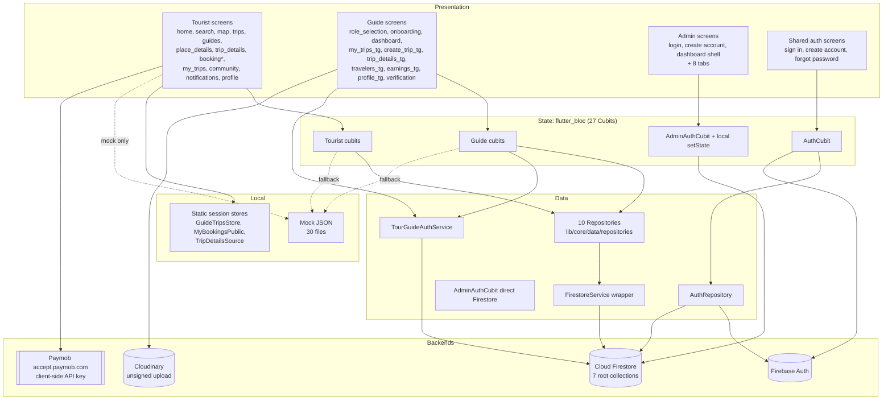
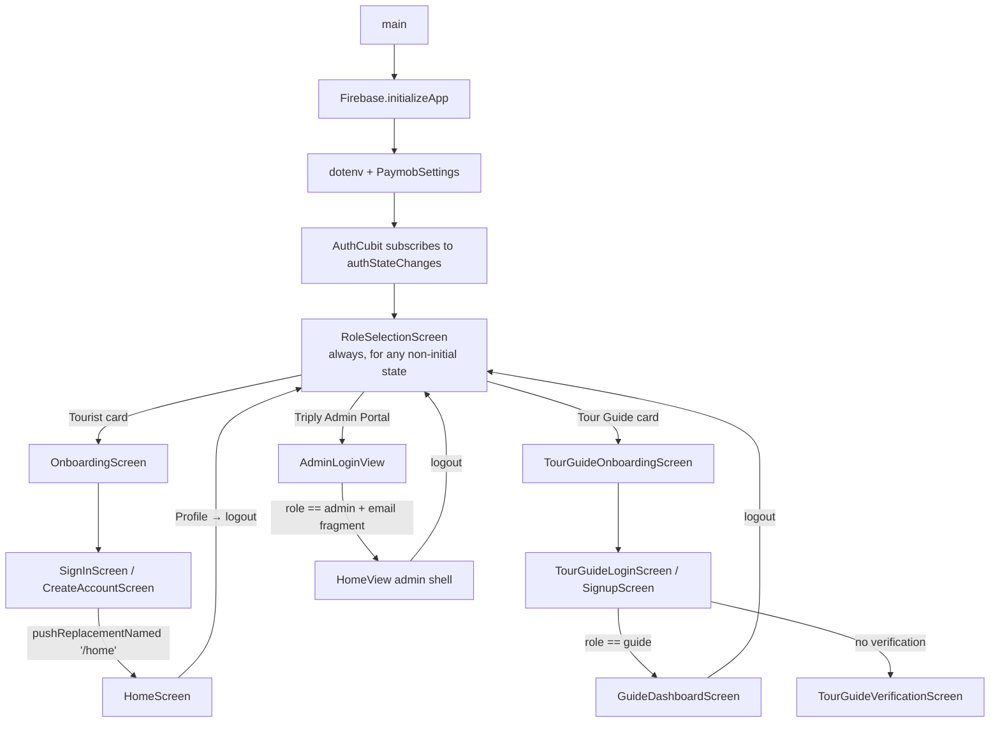
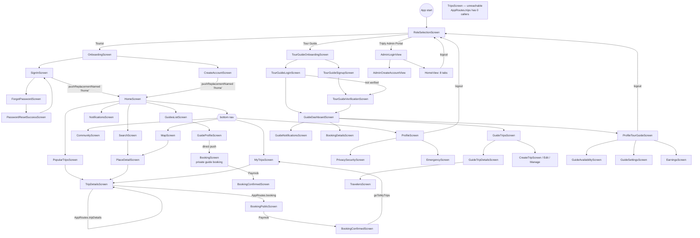
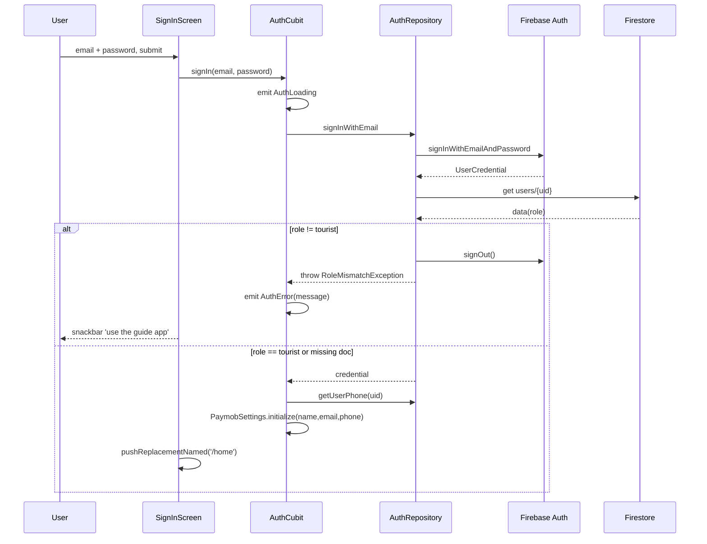
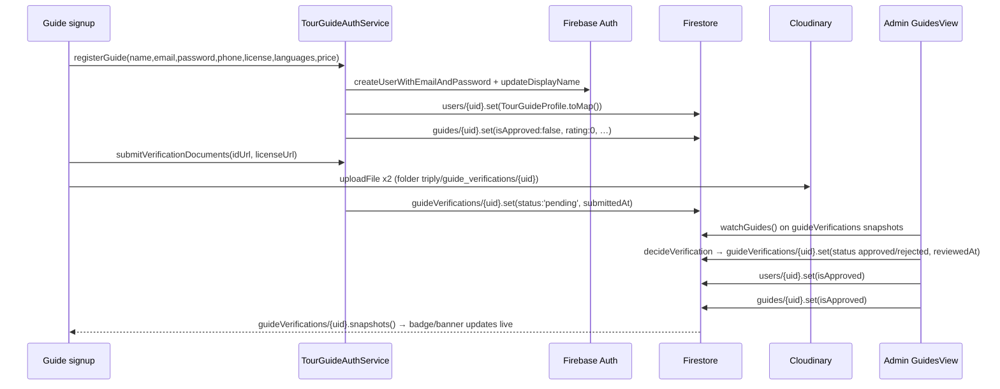
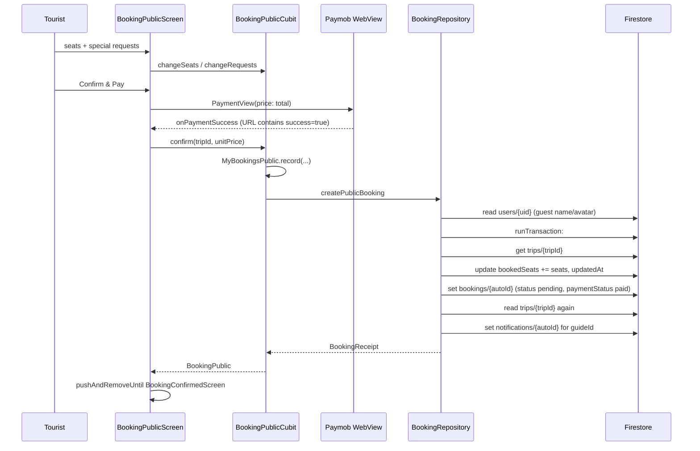
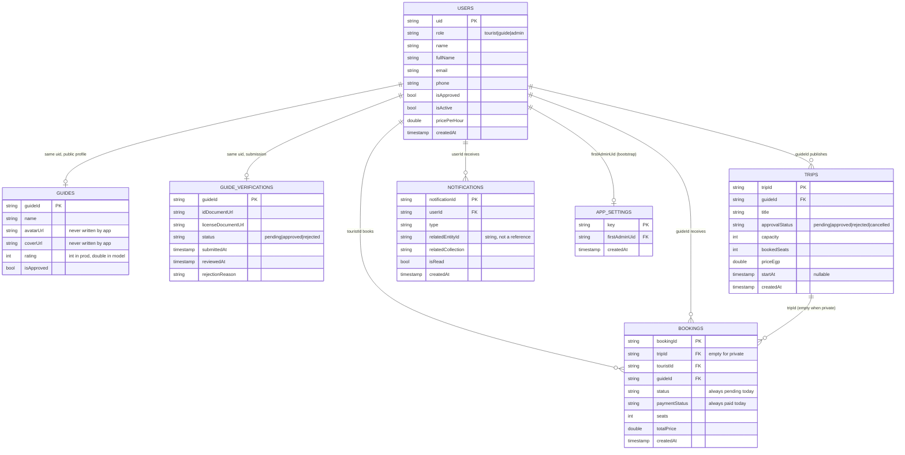
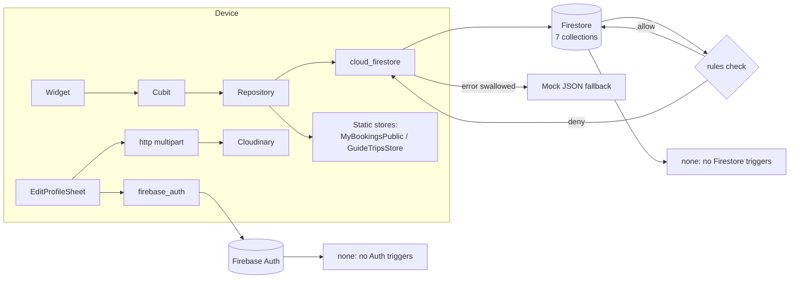

# Triply — Full Application, Backend and Firebase Technical Audit

**Status of this document:** current-state audit. It describes what exists and what is verifiably connected today. It does **not** propose a redesign, and it does **not** describe the planned Chat feature as if it existed.

---

## 1. Executive Summary

Triply is a single Flutter codebase that ships **three role-specific applications** (Tourist, Tour Guide, Admin) behind one entry point and one Firebase project. The code is organised as vertical feature slices (`lib/features/tourist`, `lib/features/tour_guide`, `lib/features/admin_dashboard`, `lib/features/common`) over a shared `lib/core` layer, with `flutter_bloc` Cubits for state and hand-instantiated repositories for data access. There is no dependency-injection container, no router package, no Cloud Functions, and no Firebase Storage bucket.

Measured size: **306 Dart files, 40,998 lines** under `lib/`, plus 30 mock-data files under `lib/core/data/mock/`.

### What is genuinely connected to Firebase today

| Area | Verdict | Evidence |
| --- | --- | --- |
| Firebase Auth (email/password) | **Working** | `AuthCubit` + `AuthRepository`; `AuthCubit` subscribes to `authStateChanges` (`lib/features/common/AuthTourist/cubit/auth_cubit.dart:20-27`) |
| Firestore `users` profiles | **Working** (dual write paths, divergent field names) | `auth_repository.dart:44`, `tour_guide_auth_service.dart:121` |
| Firestore `trips` (guide CRUD + admin approval) | **Working** | `guide_trips_repository.dart`, `admin_trips_repository.dart` |
| Firestore `guides` (public profiles) | **Partially working** — no avatar/cover write path | `tour_guide_auth_service.dart:135-190` |
| Firestore `bookings` (creation + seat reservation transaction) | **Working to create, never transitions** | `booking_repository.dart:69-160` |
| Firestore `guideVerifications` + admin decision | **Working** (real, two-sided, live) | `tour_guide_auth_service.dart:238-252`, `admin_guides_repository.dart:139-160` |
| Firestore `notifications` (in-app) | **Working** (written by clients, no push) | `guide_notifications_repository.dart:90-113` |
| Google Sign-In | **Code present, provider not enabled in production** | `auth_repository.dart:95-108`; production `signIn` config exposes only `email` |
| Paymob payments | **UI/WebView only; no server verification, no transaction record** | `booking_public_screen.dart:83-125`, `third_party/pay_with_paymob/…/visa_view.dart:67` |
| Cloudinary uploads | **Working, but with two different hardcoded unsigned presets** | `cloudinary_service.dart:8-12`, `edit_profile_sheet.dart:76-77` (both edit sheets) |
| Community / posts / stories | **Fully mocked, never touches Firebase** | `community_cubit.dart:10-28` |
| Maps, places, search | **Fully mocked** | `map_cubit.dart`, `search_cubit.dart`, `place_detail_cubit.dart` |
| Admin Overview / Users / Bookings / User Posts / App Settings | **Fully mocked** | `d_users_view.dart:6`, `d_bookings_view.dart:5`, `d_overview_view.dart:4`, `d_user_posts_view.dart:2` |
| Cloud Functions / FCM / Analytics / Crashlytics / App Check | **Do not exist** | No `functions/` directory, no SDKs in `pubspec.yaml`, APIs not enabled in production |

### The five findings that matter most before Chat

1. **There is no payment verification at all.** The client writes `paymentStatus: 'paid'` itself, at booking creation, before and independent of any server check (`lib/core/data/repositories/booking_repository.dart:144` and `:237`). "Paid" is a literal in the app, not a fact in the database about a payment.
2. **There is no booking lifecycle.** No code anywhere mutates `bookings.status` after creation. A booking is born `pending` and stays `pending` forever (`grep` for booking-status writes returns only the two creation sites). There is no accept, confirm, complete, or cancel path — and the guide's booking screen is read-only (`booking_details_cubit.dart`, no write method).
3. **There is no backend.** No Cloud Functions are deployed — and the Cloud Functions, Cloud Run, and Cloud Storage for Firebase APIs are *not even enabled* on `triply-f9b82`. Any planned "automatic chat creation through the booking-status backend workflow", "backend-managed unread counters", or "callable report function" has **no existing host to run on**. This is the single largest blocker for the Chat plan.
4. **Authentication is client-side only, and authorization has holes that matter for Chat.** The UI hides screens; the rules do the real work. But rules let any signed-in user bump `bookedSeats` on any trip, let a tourist mark their own booking `paid` with arbitrary amounts, and never check `isActive`. Account *deactivation exists as a field* (`isActive`, written by `suspendGuide`) but **nothing reads it to restrict anything** — so "read-only when either account is inactive" has no enforcement mechanism today.
5. **Profile identity is split across three places that do not agree.** Name and avatar live in Firebase Auth (`displayName`, `photoURL`), in `users/{uid}` (`name` for guides, `fullName` for tourists), and in `guides/{uid}` (`name`, `avatarUrl`, which is never written by the app). Chat's "profile snapshots" requirement has no single trustworthy source yet.

### Production status at a glance

`triply-f9b82` is verified reachable and inspected read-only. **Seven root collections exist** (`appSettings`, `bookings`, `guideVerifications`, `guides`, `notifications`, `trips`, `users`), with **no subcollections anywhere**, 13 auto-generated composite indexes, deployed Firestore rules byte-equivalent to `firestore.rules`, and **no Cloud Functions**. Full detail in §16.

---

## 2. Audit Scope, Date, Branch, and Commit

| Item | Value |
| --- | --- |
| Audit date | 2026-10-25 |
| Repository | `D:/applications flutter/triply` (working copy) |
| Branch | `main` (tracking `origin/main`) |
| Commit | `6de884319428f57967c8aa80377b9f13899385be` |
| Commit subject | `+ handle edit trip (max) + bugs change image before add trip + delete trip in guide + stream in dashboard , verify in guide flow + stream in guide , trip application in dashboard flow + test payment (wallet , visa) + handle accounts in login (admin , tourist ,guide) + handle accounts in login (admin , tourist ,guide) + add role in email admin + edit message incorrect email and ui in dashboard + handle to open popular trip in tourist and handle state in empty + delete view profile in travelers` |
| Working tree before audit | 1 pre-existing modification: `macos/Flutter/GeneratedPluginRegistrant.swift` (not touched by this audit; native plugin registrant, regenerated by Flutter tooling) |
| Tracked files | 466 |
| Firebase project (intended and verified) | `triply-f9b82` (project number `396641823945`) |

### Scope

Everything reachable from this working copy: `lib/`, `firestore.rules`, `firestore.indexes.json`, `firebase.json`, `lib/firebase_options.dart`, `pubspec.yaml`, `android/`, `ios/`, `web/`, `test/`, `third_party/pay_with_paymob/`, `tool/`, `docs/`, `assets/`, plus read-only inspection of the `triply-f9b82` production project (Firestore data/metadata, deployed rules, indexes, Auth config, Storage, Functions, apps).

### Explicit non-scope

No code was modified. No Firebase resource was created, modified, or deleted. Nothing was deployed. `GuideSeed` (`lib/core/data/seed/guide_seed.dart`) was deliberately **not executed** because it writes to Firestore.

### Method

1. Git and repository inventory.
2. Full read of the entry point, routes, every repository, every service, the auth layer, and the Firestore-facing screens.
3. Repository-wide reference analysis (`grep`) to distinguish used from orphaned code.
4. `flutter analyze --no-pub` → **0 errors, 22 info-level lints**.
5. `flutter test --no-pub` → **50 passing, 1 failing** (`test/widget_test.dart`, the stale Flutter counter template test).
6. Read-only production inspection via Firebase CLI and Google/Firebase REST APIs (`GET`/read-only aggregation), documented in §24.

### Deliverable

This single file. No other file was created or modified.

---

## 3. Project Structure and Architecture

### 3.1 Actual architecture

There is **no** repository-interface layer, no DTO/domain/entity separation, no DI container, no generated code (no `build_runner`, no `freezed`, no `json_serializable`), and no router package. The de-facto pattern is:

```
Widget (View)  →  Cubit (state)  →  Repository / Service  →  Firebase SDK or mock JSON  →  Model.fromJson
```

with three common deviations:

* **Views that call Firebase directly**, bypassing the cubit: `EditProfileSheet` (both roles) calls `FirebaseAuth.instance.currentUser.updateDisplayName/updatePhotoURL` plus an inline `http` upload; `AdminLoginView`/`AdminCreateAccountView` drive `AdminAuthCubit`; `TourGuideVerificationScreen` calls `CloudinaryService` and `TourGuideAuthService` itself.
* **Views that own local `setState` state instead of a cubit**: all five mocked admin views, `d_home_view` (tab index), `booking_public_screen` (controllers), `location_picker_view`, `story_viewer_view`.
* **Screens whose cubit silently degrades to bundled mock JSON** when Firestore is unreachable or permission-denied. This is pervasive (see §17) and makes "is this real data?" invisible at runtime.

### 3.2 Directory map

| Path | Contents | Role |
| --- | --- | --- |
| `lib/main.dart` | `main()`, `MyApp`, route table | Only entry point |
| `lib/firebase_options.dart` | Generated `FirebaseOptions` for android/ios/web; throws `UnsupportedError` for macOS/Windows/Linux | Firebase config |
| `lib/core/constants/` | `app_routes.dart` (route table + builders), `d_app_routes.dart` (**dead duplicate `AppRoutes` class**), `app_colors.dart`, `d_app_colors.dart`, `app_asset.dart`, `tour_guide_colors.dart` | Navigation + design tokens |
| `lib/core/data/remote/firestore_service.dart` | Thin `FirebaseFirestore` wrapper: `collection`, `readDoc`, `writeDoc` (merge, strips `createdAt`), `deleteDoc` | The only shared Firestore abstraction |
| `lib/core/data/repositories/` | 10 repositories: `booking`, `guide_trips`, `guide_dashboard`, `guide_notifications`, `tourist_notifications`, `public_trips`, `public_guides`, `admin_trips`, `admin_guides` (+ `FirestoreService`) | Data access |
| `lib/core/data/models/` | `public_trip`, `public_guide`, `tourist_booking` — cross-feature models | Read models |
| `lib/core/data/` | `guide_trips_store.dart`, `my_bookings_public.dart`, `trip_details_source.dart`, `guide_trip_details_source.dart` | **Static, in-memory session stores** (not persistent) |
| `lib/core/data/seed/guide_seed.dart` | `GuideSeed` — writes mock trips/notifications into Firestore | **Dormant; zero references** |
| `lib/core/data/mock/` | 30 files of hardcoded JSON fixtures | Fallback + mock-only features |
| `lib/core/services/cloudinary_service.dart` | Unsigned Cloudinary upload (verification documents) | External storage |
| `lib/core/network/api_client.dart` | `ApiConstants.baseUrl = 'https://api.triply.example'`, empty `ApiClient` | **Stub, unused** |
| `lib/core/utils/safe_emit_mixin.dart` | Guards `emit` after `close` | Used by 17 cubits |
| `lib/core/widgets/` | Shared widgets incl. `state_views.dart` (`AppLoadingView`, `AppErrorView`), `profile_avatar.dart`, `network_image_fallback.dart` | UI kit |
| `lib/features/common/AuthTourist/` | `AuthCubit`/`AuthState`, `AuthRepository`, 6 auth screens, 5 form widgets | Tourist auth |
| `lib/features/common/AuthTourguide/` | `TourGuideAuthCubit`, `TourGuideAuthService`, login/signup/verification | Guide auth |
| `lib/features/tourist/` | 14 feature folders (home, search, map, community, trips, my_trips, guides, place_details, trip_details, booking, booking_public, notifications, popular, user_profile) | Tourist app |
| `lib/features/tour_guide/` | 9 feature folders (role_selection, onboarding, create_trip_tg, my_trips_tg, trip_details_tg, travelers_tg, earnings_tg, profile_tg, home_and_notification_tg) | Guide app |
| `lib/features/admin_dashboard/` | `d_auth`, `d_home`, `d_overview`, `d_trips`, `d_users`, `d_bookings`, `d_user_posts`, `d_guides`, `d_trip_applications`, `d_app_settings` | Admin console |
| `third_party/pay_with_paymob/` | Local fork of `pay_with_paymob` (pinned via `dependency_overrides`) that injects a mobile viewport | Payment UI |
| `firestore.rules` | 297 lines, 7 match paths | Security rules |
| `firestore.indexes.json` | 4 composite indexes | Index config |
| `firebase.json` | Flutter app config + `firestore` block only — **no `functions`, no `storage`, no `hosting`** | Firebase config |
| `test/` | 5 files, 51 tests, all unit/widget | Tests |

### 3.3 Layer diagram (actual)



Legend: solid = real call; dotted = fallback path. `V3` (admin) reaches Firestore only through `AdminTripsRepository` / `AdminGuidesRepository` and `AdminAuthCubit`; five of its eight tabs never leave `mock`.

---

## 4. Application Startup and Initialization

### 4.1 The single entry point

`lib/main.dart` is the **only** `main()` in the project (`grep -rn "void main("` and `"Future<void> main("` → one hit). There are no flavor entry points (`main_dev.dart`, `main_prod.dart`), no `--dart-define` usage, and no environment abstraction.

```dart
// lib/main.dart:21-30
Future<void> main() async {
  WidgetsFlutterBinding.ensureInitialized();
  await Firebase.initializeApp(options: DefaultFirebaseOptions.currentPlatform);
  try {
    await dotenv.load(fileName: '.env');
  } catch (_) {}
  PaymobSettings.initialize();
  runApp(const MyApp());
}
```

### 4.2 Sequence, precisely

| # | Step | Code | Failure behaviour |
| --- | --- | --- | --- |
| 1 | Bindings | `WidgetsFlutterBinding.ensureInitialized()` | — |
| 2 | Firebase init | `Firebase.initializeApp(options: DefaultFirebaseOptions.currentPlatform)` | **Not wrapped in try/catch** → an init failure terminates startup with an unhandled error. Optionally, on desktop, `DefaultFirebaseOptions.currentPlatform` throws `UnsupportedError` (`firebase_options.dart:29-44`) |
| 3 | Env load | `dotenv.load(fileName: '.env')` inside `try/catch (_) {}` | Silently ignored. `PaymobSettings._envValue` also catches and falls back to empty strings |
| 4 | Paymob config | `PaymobSettings.initialize()` → `PaymentData.initialize(...)` with `PAYMOB_API_KEY`, `PAYMOB_IFRAME_ID`, `PAYMOB_INTEGRATION_ID`, `PAYMOB_WALLET_INTEGRATION_ID`; user data defaults to `'NA'` | Missing keys become `''`; the payment screen then fails at runtime, not at startup |
| 5 | App | `runApp(const MyApp())` | — |
| 6 | Provider wiring | `MultiBlocProvider(providers: [BlocProvider(create: (_) => AuthCubit())])` | `AuthCubit` constructs `AuthRepository()`, which calls `FirebaseAuth.instance` and `GoogleSignIn()` **eagerly in field initialisers** (`auth_repository.dart:26-27`) |
| 7 | Session restore | `AuthCubit` subscribes to `_authRepository.authStateChanges` in its constructor | First event flips `AuthInitial` → `AuthSuccess`/`AuthUnauthenticated` |
| 8 | First screen | `home: BlocBuilder<AuthCubit, AuthState>` — `AuthInitial` → centred `CircularProgressIndicator`; **every other state → `RoleSelectionScreen`** | See §4.3 |
| 9 | Routes | `MaterialApp.routes` map, 11 named routes | See §5.1 |
| 10 | Theme | `theme: buildAppTheme()` (`lib/core/theme/app_theme.dart`) | Single theme; admin uses parallel `d_app_*` tokens |

### 4.3 What "session restoration" actually does

It restores the **Firebase session** but never acts on it for navigation:

```dart
// lib/main.dart:44-56
home: BlocBuilder<AuthCubit, AuthState>(
  builder: (context, state) {
    switch (state) {
      case AuthInitial():
        return const Scaffold(body: Center(child: CircularProgressIndicator()));
      default:
        return const RoleSelectionScreen();
    }
  },
),
```

Consequences, all verified:

* A previously signed-in user is **still shown the role-selection screen** on every cold start. There is no auto-navigation to `/home`, the guide dashboard, or the admin shell.
* There is **no route guard anywhere**. Nothing checks `AuthCubit` before pushing a tourist screen. Tourist features therefore run while signed out and silently fall back to mock data (e.g. `GuideTripsRepository.watchTrips()` yields mocks when `uid == null`; `PublicTripsRepository` returns `null` on failure and callers swap in mocks).
* Role mismatch is enforced **after** sign-in, not before navigation: `AuthRepository._ensureTouristRole` (`auth_repository.dart:110-125`) signs the session back out and throws `RoleMismatchException` when `users/{uid}.role != 'tourist'`. The guide side does the same in `TourGuideAuthService.signInGuide` (`tour_guide_auth_service.dart:196-220`).
* `AuthCubit.close()` cancels the auth subscription; the root provider is never disposed during app life.

### 4.4 Role-dependent startup

Roles are **not** derived at startup. `main.dart` starts a neutral role chooser; the user picks a path:



There is **no shared session object** across the three apps: `AdminAuthCubit` holds an in-memory `AdminSession` (`name`, `email`) and is created per admin login; the guide app relies on `FirebaseAuth.currentUser`; the tourist app on `AuthCubit`.

### 4.5 Environment configuration

| Name | Where referenced | Purpose | Verification |
| --- | --- | --- | --- |
| `PAYMOB_API_KEY` | `paymob_settings.dart:28` | Paymob authentication (`/api/auth/tokens`) | Name only — value not read by this audit. `.env` is present locally and **not tracked by git** (`git ls-files .env` → no match) |
| `PAYMOB_INTEGRATION_ID` | `paymob_settings.dart:32` | Card integration id | Name only |
| `PAYMOB_IFRAME_ID` | `paymob_settings.dart:36` | Hosted iframe id | Name only |
| `PAYMOB_WALLET_INTEGRATION_ID` | `paymob_settings.dart:41` | Wallet integration id (optional) | Name only |

Two configuration problems worth recording now:

1. **`.env` is declared as a Flutter asset** (`pubspec.yaml`: `assets: - .env`). Any value in it is bundled into the shipped application binary and is readable by anyone who unpacks the APK/IPA. Combined with the Paymob flow (§7.9), this means a live payment credential travels with the app.
2. `PaymobSettings` "sandbox fallbacks" are all empty strings (`_fallbackApiKey = ''`, etc.), so the doc comment promising "a fresh clone still runs the whole payment flow" does not hold — with no `.env`, `PaymentData` is initialised with empty credentials and the payment screen cannot authenticate.

`firebase.json` contains no `functions`, `storage`, `hosting`, `emulators`, or `remoteconfig` blocks — only `flutter` (app registration) and `firestore` (rules + indexes).

---

## 5. Complete Screen and Navigation Inventory

### 5.1 The two route systems

| System | File | Status |
| --- | --- | --- |
| `AppRoutes` (named constants + `Route` builders) | `lib/core/constants/app_routes.dart` | **Active.** Used by `main.dart` and all tourist navigation |
| A **second class also named `AppRoutes`** | `lib/core/constants/d_app_routes.dart` | **Dead.** Zero imports (`grep -rn "d_app_routes" lib` → none). Its values also conflict (`home = '/'` vs `/home`, plus `overview`, `users`, `login`, …). Importing it would collide with the active class |

Named routes registered in `main.dart` (11): `/home`, `/search`, `/notifications`, `/onboarding`, `/sign-in`, `/create-account`, `/forgot-password` (registered as `ForgotPasswordScreen.routeName`), `/password-reset-success`, `/profile`, `/privacy-security`, `/emergency`.

Route builders in `AppRoutes`: `trips()`, `popular()`, `tripDetails()`, `booking()`, `myTrips()`, `guideTrips()`, `guideTripDetails()`, `travelers()`, `createTrip()`, `editTrip()`, `manageTrip()`, `guideProfile()`, `earnings()`, `bookingConfirmed()`, plus two navigation helpers `goToMyTrips()` and `backToTrip()`.

Reference counts (from `grep`, excluding the definitions themselves):

| Member | External references | Note |
| --- | --- | --- |
| `AppRoutes.trips()` | **0** | `TripsScreen` is therefore **unreachable** |
| `AppRoutes.backToTrip()` | **0** | Dead helper |
| `AppRoutes.onboarding` | 1 (registration only) | `RoleSelectionScreen` pushes `OnboardingScreen` directly instead |
| `AppRoutes.forgotPassword` | 1 (`privacy_security_screen.dart:44`) | **Not registered under that symbol**, but works because `ForgotPasswordScreen.routeName == '/forgot-password'` is the registered value — an accidental match of two independent constants |
| `AppRoutes.booking()` | 1 | Public-trip booking |
| `AppRoutes.popular()` | 1 | Reachable |
| others | ≥1 | Reachable |

Direct `MaterialPageRoute` navigation is used everywhere else, including the guide and admin applications (which use **no named routes at all**). Literal route strings `'/home'` are used in three places (`create_account_screen.dart:74`, `sign_in_screen.dart:39`, `sign_in_screen.dart:156`) instead of `AppRoutes.home`.

### 5.2 Screen inventory

Legend for **Status**: **Working** = real backend + UI wired end-to-end · **Partial** = real backend but with a documented gap · **Mocked** = UI operates on bundled JSON/static state only · **Disconnected** = UI exists but its action has no effect on any store · **Unverified** = cannot be confirmed without a running device.

#### Authentication and role selection

| Screen | Source | Route / mechanism | Role | Entry point | State | Data deps | Firebase ops | Local/mock | Navigation | Status |
| --- | --- | --- | --- | --- | --- | --- | --- | --- | --- | --- |
| `RoleSelectionScreen` | `tour_guide/role_selection/view/role_selection_screen.dart` | `home:` of `MaterialApp` | shared | app start | stateless | none | none | hardcoded image URLs | → `OnboardingScreen`, `TourGuideOnboardingScreen`, `AdminLoginView` | Working |
| `OnboardingScreen` (wrapper + `_OnboardingScreen`) | `common/AuthTourist/screens/onboarding_screen.dart` | `/onboarding` (registered, never pushed by name) + direct push | tourist | role card | stateful (page index) | none | none | — | → `SignInScreen` | Working |
| `SignInScreen` | `.../sign_in_screen.dart` | `/sign-in` | tourist | onboarding, edit-profile guard | `AuthCubit` | `AuthRepository` | `signInWithEmailAndPassword`, optional `signInWithGoogle` | — | `pushReplacementNamed('/home')`, `/forgot-password`, `/create-account` | Partial — Google provider not enabled in production; no `isActive` check |
| `CreateAccountScreen` | `.../create_account_screen.dart` | `/create-account` | tourist | sign-in | `AuthCubit` | `AuthRepository.signUpWithEmail` | `createUserWithEmailAndPassword`, `updateDisplayName`, `users/{uid}.set(merge)` | — | `pushReplacementNamed('/home')` | Working (profile write is best-effort `try/catch (_) {}`) |
| `ForgotPasswordScreen` | `.../forgot_password_screen.dart` | `/forgot-password` | shared | sign-in, privacy screen | `AuthCubit.sendPasswordResetEmail` | `AuthRepository` | `sendPasswordResetEmail` | — | → `PasswordResetSuccessScreen` | Working |
| `NewPasswordScreen` | `.../new_password_screen.dart` | — | shared | **nothing** | local | none | none | — | → `/password-reset-success` | **Orphaned** — never instantiated (`grep "NewPasswordScreen("` → declaration only) |
| `PasswordResetSuccessScreen` | `.../password_reset_success_screen.dart` | `/password-reset-success` | shared | forgot-password flow | stateless | none | none | — | → `/sign-in` | Working |
| `TourGuideOnboardingScreen` | `tour_guide/onboarding/view/tour_guide_onboarding_screen.dart` | direct push | guide | role card | stateful | none | none | — | → guide login/signup | Working |
| `TourGuideLoginScreen` | `common/AuthTourguide/view/tour_guide_login_screen.dart` | direct push | guide | onboarding | `TourGuideAuthCubit` | `TourGuideAuthService` | `signInWithEmailAndPassword`, reads `users/{uid}` | — | → `GuideDashboardScreen` / `TourGuideVerificationScreen` | Working (guide-role enforced, tourist/admin rejected) |
| `TourGuideSignupScreen` | `.../tour_guide_signup_screen.dart` | direct push | guide | guide login | `TourGuideAuthCubit` | `TourGuideAuthService.registerGuide` | `createUserWithEmailAndPassword`, `users/{uid}.set`, `guides/{uid}.set` | — | → verification | Working |
| `TourGuideVerificationScreen` | `.../tour_guide_verification_screen.dart` | direct push | guide | signup, dashboard banner | local `setState` + 3 `StreamBuilder`s | `CloudinaryService`, `TourGuideAuthService` | `guideVerifications/{uid}.set`, 3 `.snapshots()` | — | → `GuideDashboardScreen` (submit or "Skip for now") | Working (documents reach Cloudinary + Firestore) |
| `AdminLoginView` | `admin_dashboard/d_auth/view/admin_login_view.dart` | direct push | admin | role-selection footer | `AdminAuthCubit` | direct `FirebaseAuth` + `FirebaseFirestore` | `signInWithEmailAndPassword`, `users/{uid}.get` | — | → `HomeView` | Partial — post-login route is not server-verified; blocks non-`*triply@gmail.com*` emails client-side only (§11.5) |
| `AdminCreateAccountView` | `.../admin_create_account_view.dart` | direct push | admin | admin login | `AdminAuthCubit.createAccount` | same | `createUserWithEmailAndPassword`, `users/{uid}.set(role: admin)`, `appSettings/_bootstrap.set` | — | → `HomeView` | **Cannot succeed in production** — `_bootstrap` exists, so the rules refuse a second self-claimed admin |

#### Tourist application

| Screen | Source | Route | State mgmt | Firebase | Mock/local deps | Status |
| --- | --- | --- | --- | --- | --- | --- |
| `HomeScreen` | `tourist/home/view/home_screen.dart` | `/home` | `HomeCubit` | `trips` (approved, `take` limited), `guides` (approved, `.take(2)`), `notifications` (live) | places = mock; trips/guides fall back to mock | Partial |
| `SearchScreen` | `tourist/search/view/search_screen.dart` | `/search` | `SearchCubit` | **none** | `mock_places`, `mock_search` | Mocked |
| `MapScreen` | `tourist/map/view/map_view.dart` | direct push | `MapCubit` | **none** | `mock_places`; `flutter_map` + OSM tiles | Mocked |
| `CommunityScreen` (+ `NewPostScreen`, `NewStoryScreen`, `ShareComposerScreen`, `StoryViewerScreen`, `LocationPickerScreen`) | `tourist/community/**` | direct push | `CommunityCubit` | **none** | `mock_community`; own posts stored in cubit state only; images = local file paths | Mocked |
| `TripsScreen` | `tourist/trips/view/trips_screen.dart` | only via `AppRoutes.trips()` (**0 calls**) | `TripsCubit` | none | `mock_trips_public` | **Orphaned / unreachable** |
| `PopularTripsScreen` | `tourist/popular/view/popular_trips_screen.dart` | `AppRoutes.popular()` | `PopularCubit` | `trips` (approved) | mock fallback | Partial |
| `MyTripsScreen` | `tourist/my_trips/view/my_trips_screen.dart` | `AppRoutes.myTrips()` | `MyTripsCubit` | `bookings` where `touristId == uid`, then N reads of `trips/{id}` | `mock_trips_public` + `MyBookingsPublic` fallback | Partial — all cards forced to "Upcoming" (§7.8) |
| `GuidesListScreen` | `tourist/guides/view/guides_list_screen.dart` | direct push | `GuidesCubit` | `guides` where `isApproved == true` | mock fallback | Partial |
| `GuideProfileScreen` | `.../guides/view/guide_profile_screen.dart` | direct push | `GuideProfileCubit` | `guides/{id}`, `trips` where `guideId` + approved | mock fallback | Partial |
| `PlaceDetailScreen` | `tourist/place_details/view/place_details_view.dart` (+ About/Guides/Trips/Stories tabs) | direct push | `PlaceDetailCubit` | `trips` (approved, filtered client-side by name/city) | place, guides, stories = mock | Partial (place is mock; trips real) |
| `TripDetailsScreen` | `tourist/trip_details/view/trip_details_screen.dart` (+ tabs, `BookingBar`-like bottom bar) | `AppRoutes.tripDetails()` | `TripDetailsCubit` | `trips/{id}` | `TripDetailsSource` (mock) fallback; favourites in a static `Set` | Partial |
| `BookingPublicScreen` | `tourist/booking_public/view/booking_public_screen.dart` | `AppRoutes.booking()` | `BookingPublicCubit` | **writes** `bookings`, updates `trips.bookedSeats`, writes `notifications` (via repository) | `TripDetailsSource` | Partial — payment not verified (§7.9) |
| `BookingConfirmedScreen` | `.../booking_public/view/booking_confirmed_screen.dart` | `AppRoutes.bookingConfirmed()` | stateless | none | — | Working (display only) |
| `BookingScreen` (private guide booking) | `tourist/booking/view/booking_screen.dart` | direct push from guide profile | `BookingCubit` (mock-only) | `BookingRepository.createPrivateBooking` on confirm | `booking/model/booking.dart`, static `timeSlots`/`durations`/`meetingPoints`; Paymob | Partial — pricing from mock guide data |
| `NotificationsScreen` | `tourist/notifications/view/notifications_screen.dart` | `/notifications` | `NotificationsCubit` | `notifications` where `userId == uid` (live), `isRead` updates | mock fallback | Working |
| `ProfileScreen` | `tourist/user_profile/view/profile_screen.dart` | `/profile` | `ProfileCubit` (mock) + `AuthCubit` | reads Firebase user; `EditProfileSheet` writes Auth profile | mock stats/emergency contacts; `MyBookingsPublic.count` for trips stat | Partial |
| `PrivacySecurityScreen` | `.../privacy_security_screen.dart` | `/privacy-security` | stateless | none | — | Working (navigational shell) |
| `EmergencyScreen` | `.../emergency_screen.dart` | `/emergency` | stateless + `url_launcher` | none | `mock_emergency_contacts` | Mocked |

#### Tour Guide application

| Screen | Source | Route | State mgmt | Firebase | Mock/local deps | Status |
| --- | --- | --- | --- | --- | --- | --- |
| `GuideDashboardScreen` | `tour_guide/home_and_notification_tg/view/guide_dashboard_screen.dart` | direct push | `DashboardCubit` + `StreamBuilder` for verification | `trips`, `bookings`, `guideVerifications` (live) | mock stats fallback | Partial |
| `GuideNotificationsScreen` | `.../view/guide_notifications_screen.dart` | direct push | `GuideNotificationsCubit` | `notifications` where `userId == uid` (live) | mock fallback | Working |
| `BookingDetailsScreen` | `.../view/booking_details_screen.dart` | direct push | `BookingDetailsCubit` | `bookings/{id}` read only | mock fallback | **Partial — read-only; no accept/reject/cancel** |
| `GuideTripsScreen` | `tour_guide/my_trips_tg/view/guide_trips_screen.dart` | `AppRoutes.guideTrips()` | `GuideTripsCubit` | `trips` where `guideId == uid` (live) | `GuideTripsStore` session merge + mock fallback | Working |
| `GuideTripDetailsScreen` | `tour_guide/trip_details_tg/view/guide_trip_details_screen.dart` | `AppRoutes.guideTripDetails()` | `GuideTripDetailsCubit` | `trips/{id}` | `GuideTripDetailsSource` cache, mock fallback | Working |
| `TravelersScreen` | `tour_guide/travelers_tg/view/travelers_screen.dart` | `AppRoutes.travelers()` | `TravelersCubit` | `bookings` where `guideId` + `tripId` | mock fallback | Working |
| `CreateTripScreen` (also "Edit Trip" / "Manage Trip") | `create_trip_tg/view/create_trip_screen.dart` | `AppRoutes.createTrip()` / `editTrip()` / `manageTrip()` | `CreateTripCubit` | writes `trips` (create/update), deletes `trips` | `GuideTripsStore` | Working |
| `EarningsScreen` | `earnings_tg/view/earnings_screen.dart` | `AppRoutes.earnings()` | `EarningsCubit` | `bookings` where `guideId == uid`, sums `totalPrice` | mock fallback | Partial — "earnings" = gross booking totals, no payout model |
| `ProfileTourGuideScreen` | `profile_tg/view/profile_tour_guide_screen.dart` | `AppRoutes.guideProfile()` | `ProfileTgCubit` | `users/{uid}`, `guides/{uid}` (ensure), `guideVerifications` (live) | default avatar asset | Partial — avatar never persisted to Firestore |
| `EditProfileSheet` (guide) | `profile_tg/widgets/edit_profile_sheet.dart` | bottom sheet | local | `updateDisplayName`, `updatePhotoURL`, `users/{uid}` merge | inline Cloudinary upload | Partial |
| `GuideAvailabilityScreen` | `profile_tg/view/guide_availability_screen.dart` | direct push | local + `StreamBuilder` | reads verification only | local toggles | Mocked |
| `GuideSettingsScreen` | `profile_tg/view/guide_settings_screen.dart` | direct push | local | none | local toggles | Mocked |

#### Admin application (shell: `HomeView`, index-based, 8 tabs)

| Tab / View | Source | Data source | Status |
| --- | --- | --- | --- |
| Overview | `d_overview/view/d_overview_view.dart` | `mock_guides` + local `setState` re-encoding | **Mocked** (approve/reject buttons mutate a local list) |
| Trips | `d_trips/view/d_trips_view.dart` | `AdminTripsRepository.fetchTrips()` (real) mapped onto `MockTrip` rows; initial state `List.from(mockTrips)` | Working (real reads + real reject) |
| Users | `d_users/view/d_users_view.dart` | `mock_search` (`mockUsers`) | **Mocked** (suspend/activate toggles local list) |
| Bookings | `d_bookings/view/d_bookings_view.dart` | `d_mock_notifications` (`mockBookings`) | **Mocked** |
| User Posts | `d_user_posts/view/d_user_posts_view.dart` | `mock_places` (`mockPosts`) | **Mocked** (delete removes from local list) |
| Guides | `d_guides/view/d_guides_view.dart` | `AdminGuidesRepository.watchGuides()` | Working (live list, real approve/reject/suspend) |
| Trip Applications | `d_trip_applications/view/d_trip_applications_view.dart` | `AdminTripApplications` from `watchTrips()` | Working (real approve/reject) |
| App Settings | `d_app_settings/view/d_app_settings_view.dart` | none | **Mocked** — commission field and approval mode are local; nothing is persisted |

Dialogs: `_ViewBookingDialog`, `_ViewTripDialog`, `_ViewUserDialog`, `_GuideDetailsDialog` — all display-only.

### 5.3 Navigation map



### 5.4 Navigation defects found

| Defect | Evidence | Impact |
| --- | --- | --- |
| `TripsScreen` unreachable | Only instantiated inside `AppRoutes.trips()` (`app_routes.dart:50`); that builder has **0** callers | A whole tourist screen and its cubit are dead code |
| `NewPasswordScreen` unreachable | Constructor requires `oobCode`; no instantiation anywhere | The in-app "new password" step cannot be reached (reset works only via e-mail link) |
| `/onboarding` registered but never pushed by name | `main.dart:66`; `RoleSelectionScreen` pushes the widget directly | Harmless, but the named route is dead |
| Duplicate route class | `lib/core/constants/d_app_routes.dart` defines a second `AppRoutes` (never imported) | Importing it would silently collide with the live class |
| Route key mismatch by luck | `AppRoutes.forgotPassword = '/forgot-password'`, but `main.dart` registers `ForgotPasswordScreen.routeName` (same literal, different symbol) | Works today; renaming either breaks the other silently |
| Duplicate `/home` literal | `sign_in_screen.dart:39,156`, `create_account_screen.dart:74` use `'/home'` instead of `AppRoutes.home` | Bypasses the route table |
| No route guard | No screen checks `AuthCubit` before rendering | Signed-out users enter tourist screens that silently serve mock data |
| Admin shell is not routed | `HomeView` uses `_selectedIndex` + `_bodies` list | Back button cannot return to a previous admin tab; tab state survives only while mounted |

---

## 6. UI and State Management

### 6.1 Cubit inventory (27 cubits, no Bloc classes)

| Cubit | File | State | Backend | Notes |
| --- | --- | --- | --- | --- |
| `AuthCubit` | `common/AuthTourist/cubit/auth_cubit.dart` | sealed: `AuthInitial`, `AuthLoading`, `AuthSuccess(user)`, `AuthUnauthenticated`, `AuthError(error)` | Firebase Auth + `users/{uid}` read | Root provider; subscribes to `authStateChanges`; `refreshUser()` re-reads the Auth user; `clearError()` emits `AuthUnauthenticated` |
| `TourGuideAuthCubit` | `common/AuthTourguide/cubit/tour_guide_auth_cubit.dart` | own state file | `TourGuideAuthService` | Guide signup/login/verification orchestration |
| `AdminAuthCubit` | `admin_dashboard/d_auth/cubit/admin_auth_cubit.dart` | `AdminAuthInitial/Loading/Success(session)/Error/LoggedOut` | direct `FirebaseAuth` + Firestore | Also enforces a **client-side email fragment** rule (§11.5) |
| `HomeCubit` | `tourist/home/cubit/home_cubit.dart` | `HomeInitial/Loading/Success/Error` | `trips`, `guides`, `notifications` | Holds `unreadNotifications`; places are mock |
| `SearchCubit` | `tourist/search/cubit/search_cubit.dart` | query/filter/recent | none | Entirely `mock_places` |
| `MapCubit` | `tourist/map/cubit/map_cubit.dart` | markers/filters | none | `mock_places` |
| `CommunityCubit` | `tourist/community/cubit/community_cubit.dart` | stories/myStories/posts | none | Mutates model objects in place (`post.isLiked = …`) then `emit` copies |
| `TripsCubit` | `tourist/trips/cubit/trips_cubit.dart` | tab + list | none | Unreachable screen |
| `TripDetailsCubit` | `tourist/trip_details/cubit/trip_details_cubit.dart` | tab, details, `isFavorite` | `trips/{id}` | `static final Set<String> _favoriteIds` = session-only favourites, lost on restart |
| `BookingPublicCubit` | `tourist/booking_public/cubit/booking_public_cubit.dart` | seats, maxSpots, requests | `BookingRepository` | 5% service fee computed client-side |
| `BookingCubit` | `tourist/booking/cubit/booking_cubit.dart` | private booking form | none (mock lists) | Static `timeSlots`, `durations`, `meetingPoints` |
| `MyTripsCubit` | `tourist/my_trips/cubit/my_trips_cubit.dart` | `MyTripsInitial/Loading/Success/Error` | `bookings` + `trips` | Forces every card to `TripStatus.upcoming` |
| `GuidesCubit` | `tourist/guides/cubit/guides_cubit.dart` | list/filters | `guides` | mock fallback |
| `GuideProfileCubit` | `tourist/guides/cubit/guide_profile_cubit.dart` | guide + trips | `guides/{id}`, `trips` | mock fallback |
| `PlaceDetailCubit` | `tourist/place_details/cubit/place_detail_cubit.dart` | place/guides/trips/stories/tab | `trips` | Matches place by **string name/city** against trip `location` |
| `PopularCubit` | `tourist/popular/cubit/popular_cubit.dart` | list | `trips` | |
| `NotificationsCubit` | `tourist/notifications/cubit/notifications_cubit.dart` | `today`/`earlier`, unread count | `notifications` (live) | `markAllRead` loops per document |
| `ProfileCubit` | `tourist/user_profile/cubit/profile_cubit.dart` | language, toggles | none | Stats/emergency contacts from mock; `trips` stat from `MyBookingsPublic.count` |
| `DashboardCubit` | `tour_guide/home_and_notification_tg/cubit/dashboard_cubit.dart` | stats + bookings | `trips`, `bookings` | Guide name/avatar in stats come from `mockGuideDashboardRaw` |
| `BookingDetailsCubit` | `.../cubit/booking_details_cubit.dart` | `Initial/Loading/Success(details)/Error` | `bookings/{id}` | **Read-only** |
| `GuideNotificationsCubit` | `.../cubit/guide_notifications_cubit.dart` | list | `notifications` (live) | |
| `GuideTripsCubit` | `my_trips_tg/cubit/guide_trips_cubit.dart` | tab + list | `trips` (live) | Merges `GuideTripsStore` session cache |
| `GuideTripDetailsCubit` | `trip_details_tg/cubit/guide_trip_details_cubit.dart` | details | `trips/{id}` | |
| `TravelersCubit` | `travelers_tg/cubit/travelers_cubit.dart` | list | `bookings` where `guideId`+`tripId` | mock fallback |
| `CreateTripCubit` | `create_trip_tg/cubit/create_trip_cubit.dart` | form + rows + cover | `GuideTripsRepository` | Owns 14 `TextEditingController`s; disposed in `close()` |
| `EarningsCubit` | `earnings_tg/cubit/earnings_cubit.dart` | summary | `bookings` | Sums `totalPrice` (gross) |
| `ProfileTgCubit` | `profile_tg/cubit/profile_tg_cubit.dart` | profile + overrides | `users/{uid}`, `guides/{uid}`, live verification | Avatar = Firebase `photoURL` or bundled default |

### 6.2 Patterns actually used

* **`SafeEmitMixin`** (`lib/core/utils/safe_emit_mixin.dart`) — used by 17 cubits to avoid `emit` after `close`. Cubits without it (`AuthCubit`, `CommunityCubit`, `CreateTripCubit`, `MapCubit`, `SearchCubit`, `TripsCubit`, `BookingCubit`, `ProfileCubit`, `AdminAuthCubit`) rely on the caller disposing correctly.
* **`part`/`part of` state files** — every cubit keeps its state in a sibling `*_state.dart` as `part of`, so states cannot be imported independently.
* **`copyWith`** — present on most state classes; `CommunityState`, `GuideNotificationsState`, etc. Missing on some (`BookingDetailsState` is a sealed class with payloads).
* **Immutable state re-emission** — `ProfileTgCubit._refreshVerificationOnly` and `CreateTripCubit._emitForm` rebuild the full state object; no `Equatable`, so `BlocBuilder` rebuilds on visually identical states.
* **`StreamBuilder` in views (5 uses)** — `tour_guide_verification_screen.dart` (3), `guide_dashboard_screen.dart`, `guide_availability_screen.dart`. These are the only places a view subscribes to Firestore directly, bypassing its cubit.

### 6.3 Error handling: the silent-fallback pattern

This is the dominant failure mode and the reason "does the app work?" is hard to answer from the UI.

| Pattern | Locations | Effect |
| --- | --- | --- |
| `catch (_) { return null; }` then caller swaps in mock | `public_trips_repository.dart:26-38,47-63`, `public_guides_repository.dart:22-35,42-53`, `booking_repository.dart:170-186` | A permission denial looks exactly like an empty dataset, and mock trips appear to be real |
| `catch (_) { return const []; }` | `admin_trips_repository.dart:88-97`, `admin_guides_repository.dart:69-107` | Admin sees an empty table instead of an error |
| `catch (_) { return _mockX(); }` | `guide_trips_repository.dart:56-104`, `guide_dashboard_repository.dart:75-110,124-260`, both notification repositories | Guide screens show fabricated bookings/earnings when Firestore fails |
| `catch (_) {}` on writes | `auth_repository.dart:41-54` (profile save), `tour_guide_auth_service.dart:184-190` (`ensurePublicProfile`), `guide_notifications_repository.dart:110-112` (`create` returns `null`) | A refused write is indistinguishable from success in the UI |
| `debugPrint` + rethrow | `guide_trips_repository.dart:119-135` | The only place a rule rejection is surfaced with the offending field values |

UI state coverage: `lib/core/widgets/state_views.dart` provides `AppLoadingView` and `AppErrorView`, but they are used by only a subset of screens. Many screens render their previous list and never show an error (`AdminTripsRepository`-backed views), while others show mock content in the success state.

### 6.4 Validation inventory (client-side only)

| Form | Rules | File |
| --- | --- | --- |
| Tourist sign-in | email present; password ≥ 6 | `sign_in_screen.dart:94-112` |
| Tourist sign-up | name non-empty; Egyptian mobile normalised to `1[0125]xxxxxxxx`; password ≥ 6; confirm matches | `create_account_screen.dart:53-61,113-191` |
| Guide sign-up | name ≥ 3; Egyptian phone; license non-empty; password ≥ 6; confirm | `tour_guide_signup_screen.dart:121-220` |
| Guide verification | extension in `jpg/png/pdf`; ≤ 10 MB | `tour_guide_verification_screen.dart:39-70` |
| Admin login/create | email must contain `triply@gmail.com`; name non-empty; password ≥ 6 | `admin_auth_cubit.dart:52,120-140` |
| Create trip | name + price required (cubit-side); capacity parsed from text | `create_trip_cubit.dart` (`submitTrip`) |
| Booking seats | clamped to `1..maxSpots` | `booking_public_cubit.dart:26-40` |

There is **no** server-side validation of any of these except what the Firestore rules re-check (`trips` create fields, `bookings` create fields, `guideVerifications` key allow-list). Notably, **admin e-mail format is not enforced server-side at all** — it exists only in Dart.

### 6.5 Caching and local persistence

| Mechanism | File | Persistence |
| --- | --- | --- |
| `GuideTripsStore` | `core/data/guide_trips_store.dart` | Static lists (`_created`, `_updated`, `_deleted`) + listener list. **Memory only** |
| `MyBookingsPublic` | `core/data/my_bookings_public.dart` | Static `Map<String,_BookingEntry>`. **Memory only**; explicit `statusPending` default |
| `TripDetailsSource` | `core/data/trip_details_source.dart` | Reads bundled mock JSON; falls back to the first mock entry, preserving the trip's card fields |
| `GuideTripDetailsSource` | `core/data/guide_trip_details_source.dart` | Static cache of details written during list reads |
| `TripDetailsCubit._favoriteIds` | `trip_details_cubit.dart:24` | Static `Set`. Favourites are lost on restart; there is no favourites collection |
| `ProfileTgCubit` bookmark | `profile_tg_cubit.dart` | UI-local only, documented as such |

No `shared_preferences`, `hive`, `sqflite`, `flutter_secure_storage`, or Firestore offline-persistence configuration exists anywhere (`pubspec.yaml` has none of these packages).

---

## 7. User Flows and Business Logic

For each flow: **UI → state → data → Firebase → result**. Contradictions with the code comments are called out explicitly.

### 7.1 Startup, sign-in and role resolution



Important details:

* A **missing** `users/{uid}` document is treated as a tourist (`auth_repository.dart:110-125` and `_roleOf` returning `null` on error). This is deliberate for new Google accounts, but it also means a Firestore read failure (offline, rules) lets a guide into the tourist app.
* The role is **read once** at sign-in. It is never re-checked during the session, so changing `users/{uid}.role` does not affect a live session until the next sign-in.
* There is no `emailVerified` gate, no `isActive` gate, and no server-side enforcement that a tourist session belongs to a tourist.

### 7.2 Tourist sign-up

`CreateAccountScreen` → `AuthCubit.signUp` → `AuthRepository.signUpWithEmail` → `createUserWithEmailAndPassword` → `updateDisplayName` → **best-effort** `users/{uid}.set({fullName, email, role:'tourist', phone?, createdAt}, merge:true)` inside `try/catch (_) {}` → `PaymobSettings.initialize` → `pushReplacementNamed('/home')`.

Consequence: if the profile write is refused (e.g. a rules change) sign-up still "succeeds" and the account behaves as a tourist by the missing-document rule. `users.fullName` is written here, while guides write `users.name` — see §8.4.

### 7.3 Guide sign-up and verification (bidirectional and working)



This is the **most complete cross-role flow in the app**: documents reach Cloudinary, the submission reaches Firestore, the admin decision is written to three documents, and the guide's banner and profile badge update through snapshots (`tour_guide_auth_service.dart:355-370`, `profile_tg_cubit.dart:35-50`).

Gaps: the file allow-list is client-side only (rules only constrain keys, not MIME/size); the admin's decision is a plain client write (allowed by `isAdmin()`); and `admin_guides_repository.dart:139-160` writes the three documents **non-atomically**, so a partial failure can leave `guideVerifications.status='approved'` with `users.isApproved=false` or vice-versa.

### 7.4 Trip creation, editing, deletion (guide)

`CreateTripScreen` → `CreateTripCubit.submitTrip` → builds `GuideTrip` with `id: 'trip-${DateTime.now().millisecondsSinceEpoch}'` (`create_trip_cubit.dart:283`) → `GuideTripsRepository.createTrip` → `writeDoc('trips', id, doc, merge:false)`.

Document shape (`guide_trips_repository.dart:184-235`): 33 fields combining card + long-form details, `approvalStatus` from the model (always `pending` for new trips), `bookedSeats` from the model, `createdAt`/`updatedAt` = `FieldValue.serverTimestamp()`.

Rules that must pass: signed in, `guideId == uid`, `approvalStatus == 'pending'`, `title` is string, `priceEgp` is number, `capacity` is int > 0, `bookedSeats == 0`.

Edit: `updateTrip` calls the same mapper with `merge:true`; the rules pin `guideId`, pin `bookedSeats`, and require `approvalStatus` unchanged (or `rejected → pending`). Delete: `deleteTrip` → `deleteDoc('trips', id)`; rules allow the owner. After a successful write the repository also mutates `GuideTripsStore`, so the list updates before the snapshot arrives.

Risk: the client-supplied `bookedSeats` is written on edit. If a guide loads the form while a booking exists and then saves, `bookedSeats` is pinned by the rules to its stored value — so the write is refused rather than corrupting the counter. The comment in `create_trip_cubit.dart` about capacity is not a race-safe guarantee (nothing re-reads the trip before writing).

### 7.5 Public trip booking — the critical path



Transaction correctness (verified): capacity is re-read inside the transaction and the booking is refused when `free < seats` (`booking_repository.dart:86-116`), so double-booking of the last seat is prevented *at booking time*.

What is **not** correct:

* `paymentStatus: 'paid'` is a **hardcoded literal** written by the client (`:144`), immediately after a WebView navigation callback. No Paymob order id, transaction id, amount, or HMAC is stored. Nothing reconciles the amount actually charged with `totalPrice`.
* The booking is created **after** payment, so a failure in the transaction leaves the tourist charged with no booking (the code only releases the local `MyBookingsPublic` record).
* `status: 'pending'` is also a literal; nothing ever changes it (§7.8).
* `unitPrice` is **passed in from the client** (`booking_public_screen.dart:106`), and `totalPrice` is derived from it, so a modified client can book at any price. The rules only require `totalPrice is number`.
* `guest_name`/`avatar_url` are denormalised from `users/{uid}` at booking time and never updated.

### 7.6 Private guide booking

`GuideProfileScreen` → `BookingScreen(guideId)` → `BookingCubit` (mock lists for duration/meeting points, price from mock/loaded guide) → Paymob → `BookingRepository.createPrivateBooking` → `bookings` document with `tripId: ''`, `is_private: true`, `paymentStatus: 'paid'`, plus a guide notification.

Because `tripId` is empty, the Firestore-backed `MyTripsCubit` path cannot render it (§7.8).

### 7.7 Payment initiation and "verification"

There is **no** `verifyPaymobTransaction` function, callable, or method anywhere in the repository (verified by `grep -rn "verifyPaymob\|verifyTransaction\|transactionId" lib` → no hits, and there is no `functions/` directory). What exists:

1. `PaymentData.initialize(...)` with `PAYMOB_API_KEY`, `PAYMOB_IFRAME_ID`, `PAYMOB_INTEGRATION_ID`, `PAYMOB_WALLET_INTEGRATION_ID` from `.env` (bundled asset), and tourist billing data from `PaymobSettings.initialize(name,email,phone)`.
2. `PaymentView` (`third_party/pay_with_paymob/lib/src/views/payment_view.dart`) authenticates against `https://accept.paymob.com/api` **from the device** using that API key (`dio_helper.dart:4-12`), creates an order, requests a payment key, and opens the iframe/WebView.
3. Success is detected by inspecting the WebView's URL for `success=true` / `success=false` (`visa_view.dart:67-71`).
4. `onPaymentSuccess` is a `VoidCallback` — no payload, no id, no amount.

Therefore the app's notion of "payment verified" is *a substring match in a client-controlled URL*. This is the exact requirement the Chat plan depends on ("booking confirmed **and** payment verified").

### 7.8 Booking status, My Trips, and cancellation

* **No status transitions exist.** `grep` across `lib` for writes to booking status returns only the two creation sites (`:141` public, `:234` private). There is no accept/confirm/complete/cancel anywhere; the guide's `BookingDetailsScreen` has no action buttons and `BookingDetailsCubit` has only `load()`.
* `MyTripsCubit._cardOf` builds every card with `status: TripStatus.upcoming` regardless of `booking.status` (`my_trips_cubit.dart:110-126`), then filters the list by that same status. **Every booking therefore appears under "Upcoming"; the Completed/Cancelled tabs are structurally always empty.**
* `_statusByTrip` stores the real status but nothing reads it.
* Private bookings (`tripId == ''`) are dropped from the Firestore path because `PublicTripsRepository.fetchTripsByIds` filters empty ids (`public_trips_repository.dart:87`); they appear only via the in-memory fallback (`MyBookingsPublic`), i.e. only in the same app session.
* **The delete/cancel flow is cosmetic and makes a false refund claim.** `MyTripsScreen._confirmDelete` (`my_trips_screen.dart:52-95`) shows a dialog reading *"Are you sure you want to delete this trip? The paid amount will be refunded to your visa."*, then calls `MyBookingsPublic.cancelBooking(trip.id)` — which only removes the entry from the **in-memory** static map — calls `MyTripsCubit.refresh()`, and shows a snackbar *"Trip deleted. EGP X has been refunded to your visa."*
  * No Firestore document is deleted or updated; no refund is issued; `trips.bookedSeats` is not decremented; no Paymob refund API is called (no such integration exists).
  * For a Firestore-backed booking the in-memory map has no entry, so `cancelBooking` returns `0` and the snackbar reads "EGP 0 has been refunded"; the booking then **reappears** after `refresh()` re-reads Firestore.
  * The rules would only permit a tourist to delete their booking while `paymentStatus == 'pending'` — a state the app never produces (every booking is created `'paid'`).
  * A private booking shows the amount with a `$` sign (line 82) while every other amount in the app is EGP.
  * Net effect: the tourist is told they were refunded when neither the booking nor the money moved. This is the most user-deceptive behaviour found in the app.

### 7.9 Trip discovery and search

* `HomeCubit.load()` reads `trips` where `approvalStatus == 'approved'`, `guides` where `isApproved == true` (only `.take(2)` are shown), and subscribes to the user's notifications. Places remain mock. Any failure swaps in mocks.
* `SearchCubit` never queries Firestore: it filters a static `mockPlaces` list by lowercase substring.
* `PlaceDetailCubit` reads all approved trips and filters them client-side by matching the place's `name`/city against the trip's free-text `location`. If nothing matches it returns **every** approved trip (`place_detail_cubit.dart` comment + `_tripsOfPlace`).
* `TripDetailsCubit` fetches `trips/{id}`; on failure it renders `TripDetailsSource` mock copy, which can show a *different* trip's about/itinerary (the fallback keeps title/image/price/guide of the real trip but reuses the first mock entry's long-form content).

### 7.10 Posts, stories, favourites, reviews

| Feature | Reality |
| --- | --- |
| Posts / stories | `CommunityCubit` seeded from `mock_community`; new posts/stories are appended to in-memory state with local file paths; `currentUserId = 'me'`; likes toggle a mutable field on the model. **No Firestore, no upload.** The admin `User Posts` tab operates on an unrelated mock list. |
| Favourites | `TripDetailsCubit._favoriteIds` static set; no collection, no persistence. |
| Reviews / ratings | No write path anywhere. `trips.rating`, `trips.reviewsCount`, `guides.rating`, `guides.reviewCount` are **written once as zeros** and never updated. No `reviews` collection exists. |
| Emergency contacts | `mock_emergency_contacts`; `tel:` launch via `url_launcher`. |

### 7.11 Admin approval flows

Trips: `TripApplicationsView` (live) and `TripsView` (fetch-on-demand) → `AdminTripsRepository.decide()` → `trips/{id}.set({approvalStatus, rejectionReason, updatedAt}, merge)` → then reads the trip back and writes a `notifications` document for the guide (`type: 'trip_decided'`). `cancel()` writes `approvalStatus: 'cancelled'` + notification.

Guides: `GuidesView` → `watchGuides()` (a listener on `guideVerifications` that re-runs a **full** `fetchGuides()` on every emission) → `decideVerification()` writes the three documents described in §7.3, or `suspendGuide()` writes `users.isApproved=false`, `users.isActive=false`, `guides.isApproved=false`.

`UsersView`, `BookingsView`, `UserPostsView`, `OverviewView`, `AppSettingsView` mutate only their local lists.

### 7.12 Notifications and logout

Notifications are **in-app only**. Writers: `BookingRepository` (tourist → guide, `type: 'booking'`), `AdminTripsRepository` (admin → guide, `type: 'trip_decided'`). Readers: `TouristNotificationsRepository` and `GuideNotificationsRepository`, both keyed by `userId` with live snapshots and `isRead` flips. There is no FCM, no device token storage, no push, and no notification is ever sent to a tourist.

Logout: tourist `AuthCubit.signOut` → `GoogleSignIn.signOut` + `FirebaseAuth.signOut`; guide `TourGuideAuthService.signOut`; admin `AdminAuthCubit.logout` (emits `AdminAuthLoggedOut`) then `pushAndRemoveUntil(RoleSelectionScreen)`. None of them clears `MyBookingsPublic`, `GuideTripsStore`, `TripDetailsSource`, or `_favoriteIds` — those statics survive a sign-out and are visible to the next account on the same device. **This is a real data-leak between sessions on a shared device.**

---

## 8. Models and Data Serialization

### 8.1 Serialization approach

No code generation. Every model is a hand-written immutable class with `fromJson`/`toJson` or `fromDocument`/`toMap` and exhaustive defaults (`...?data` merged over a default map, then fields cast with `as String?` + `?? ''`). Timestamps are read either as `Timestamp` (checked explicitly, e.g. `admin_trips_repository._submittedLabel`, `tourist_notifications_repository._timeLabel`) or converted with `parseGuideDate` (`guide_trip.dart:29-36`) which accepts `Timestamp`, ISO `String`, or `DateTime`. Writes use `FieldValue.serverTimestamp()`.

### 8.2 Model inventory

| Model | File | Key fields | Maps to | Used by |
| --- | --- | --- | --- | --- |
| `PublicTrip` (+`PublicItineraryStop`) | `core/data/models/public_trip.dart` | `id, guideId, title, location, dateLabel←scheduleLabel, durationLabel←duration, imageUrl, guideName, guideAvatarUrl, tag, priceEgp, capacity, bookedSeats, rating, reviewsCount, groupType, languages, about, highlights[], itinerary[{time,title}], notes[], included, meetingPoint, guideRating, guideReviews` | `trips/{id}` | Home, popular, place details, my trips |
| `PublicGuide` | `core/data/models/public_guide.dart` | `id, name, specialty, avatarUrl, coverUrl, location, about, languages[], rating, reviewCount, pricePerHour, currency (default '$'), isApproved` | `guides/{id}` | Home (2 only), guides list, guide profile |
| `TouristBooking` | `core/data/models/tourist_booking.dart` | `id, tripId, tourTitle←tour_title, seats (falls back to traveler_count), totalPrice, status` | `bookings/{id}` | My Trips |
| `GuideTrip` (+ enums `GuideTripApproval{pending,approved,rejected,cancelled}`, `GuideTripStatus{active,pending,rejected,completed,cancelled}`) | `tour_guide/my_trips_tg/model/guide_trip.dart` | `id, title, location, scheduleLabel, priceEgp, imageUrl, approval←approvalStatus, capacity, bookedSeats, phone, duration?, rejectionReason?, startAt?, coverUrl, guideId`; `status` getter derives tab from approval + `startAt` | `trips/*` | Guide app, admin |
| `GuideTripDetails` (+`GuideItineraryStop`) | `tour_guide/trip_details_tg/model/guide_trip_details.dart` | 22 fields incl. `tag, rating, reviewsCount, groupType, languages, about, highlights[], itinerary[], notes[], included, meetingPoint, guideName, guideAvatarUrl, guideRating, guideReviews, imageUrl` | Same document as `GuideTrip` | Guide details/edit |
| `BookingRequest` | `home_and_notification_tg/model/guide_dashboard_booking_request.dart` | `id, guest_name, tour_title, detail_label, avatar_url, is_private` | `bookings` | Guide dashboard |
| `BookingDetails` | `.../model/booking_details.dart` | `id, guest_name, country, traveler_count, avatar_url, is_private, tour_title, datetime_label, location, booking_code, price_label, paymentStatus, …` | `bookings/{id}` | Guide booking details |
| `Traveler` | `travelers_tg/model/traveler.dart` | `id←touristId, tripId, name←guest_name, tagline←country, avatarUrl, seatsLabel` | `bookings` | Travelers screen |
| `GuideNotification` | `.../model/guide_notification.dart` | `id, type, title, message, isRead, createdAt` | `notifications` | Guide notifications |
| `NotificationItem` | `tourist/notifications/model/notification_item.dart` | `id, type, title, body←message, is_read←isRead, time_label, section(today/earlier)` | `notifications` | Tourist notifications |
| `AdminTrip` | `core/data/repositories/admin_trips_repository.dart` (co-located) | `tripId, title, guideName, guideId, location, approvalStatus, scheduleLabel, bookedSeats, capacity, priceEgp, rejectionReason, about, itinerary[], imageUrl` | `trips` | Admin trips/applications |
| `AdminGuide` / `AdminGuideTrip` | `core/data/repositories/admin_guides_repository.dart` (co-located) | `uid, name, email, phone, city←location, document, status, submitted, docFileName, uploadedTrips[]` | `users` + `guideVerifications` + `trips` | Admin guides |
| `TourGuideProfile` | `common/AuthTourguide/data/tour_guide_auth_service.dart` (co-located) | `uid, name, email, phone, role, licenseNumber, languages[], isApproved, about, location, pricePerHour` | `users/{uid}` | Guide auth/profile |
| `AdminSession` | `admin_dashboard/d_auth/model/admin_session.dart` | `name, email` | none (in-memory) | Admin shell header |
| `CommunityPost` / `CommunityStory` | `tourist/community/model/*` | feed fields + `isMine`, `isLocalImage` | none | Community (mock) |
| `Trip` (3 variants) | `tourist/home/model/trip.dart`, `tourist/trips/models/trip.dart`, `tourist/trip_details/model/trip_details.dart`; plus `guides/model/trip.dart`, `place_details/model/trip.dart` | card fields | conversions from `PublicTrip` | Tourist screens |
| `Guide` (3 variants) | `tourist/home/model/guide.dart`, `guides/model/guide.dart`, `place_details/model/guide.dart`; also `tour_guide/profile_tg/model/guide.dart` | card fields | conversions from `PublicGuide` | Tourist + guide screens |
| `Place` (3 variants) | `home/model/place.dart`, `map/model/place.dart`, `place_details/model/place.dart` | mock place fields | mock JSON | Search/map/place |
| `BookingPublic` | `tourist/booking_public/model/booking_public.dart` | `tripId, seats, specialRequests, unitPrice, serviceFee, total` | transient | Public booking cubit |
| `EarningsSummary`/`EarningActivity` | `earnings_tg/model/earnings.dart` | `availableBalance, month, activities[]` | derived from `bookings` | Earnings |
| `EmergencyContact` | `user_profile/model/emergency_contact.dart` | mock | mock JSON | Emergency screen |

### 8.3 Duplicate and conflicting model representations

| Conceptual entity | Representations | Conflict |
| --- | --- | --- |
| Trip | `PublicTrip`, `GuideTrip`, `GuideTripDetails`, `AdminTrip`, `Trip` ×5 (home/trips/guides/place_details/trip_details) | Same Firestore document is read into 8 shapes; `imageUrl` vs `coverUrl` preference differs per reader (e.g. `PublicTrip` uses `imageUrl`; `GuideTripsRepository._toDetails` uses `coverUrl ?? imageUrl`; `AdminTrip` uses `coverUrl ?? imageUrl`) |
| Guide | `PublicGuide`, `TourGuideProfile`, `AdminGuide`, `ProfileTgCubit` state, `Guide` ×4 | `users` doc vs `guides` doc vs Auth profile; `rating` is `int` in production `guides` but `double` in `PublicGuide` |
| Booking | `TouristBooking`, `BookingRequest`, `BookingDetails`, `Traveler`, `MockBooking` (admin), `BookingPublic` | `MockBooking` is unrelated to Firestore; `seats` vs `traveler_count` duplication |
| Approval | `users.isApproved`, `guides.isApproved`, `guideVerifications.status`, `TourGuideProfile._isApproved` (reads a legacy `verification{}` map that **no writer produces**) | **Four sources of truth** for one decision |
| Routes | `AppRoutes` ×2 | Duplicate class name, conflicting values |

### 8.4 Field-name divergence between the two user writers

| Writer | Writes | File |
| --- | --- | --- |
| Tourist sign-up | `fullName`, `email`, `role`, `phone?`, `createdAt` | `auth_repository.dart:44-52` |
| Guide sign-up | `uid`, `name`, `email`, `phone`, `role`, `licenseNumber`, `languages`, `isApproved`, `pricePerHour`, `createdAt` | `tour_guide_auth_service.dart:33-45,121` |
| Guide profile edit | `name`, `about`, `location`, `phone`, `pricePerHour` (merge) | `tour_guide_auth_service.dart:296-310` |
| Admin create account | `uid`, `name`, `email`, `role`, `isActive`, `createdAt` | `admin_auth_cubit.dart:144-158` |
| Admin verification decision | `isApproved` | `admin_guides_repository.dart:145-158` |
| Admin suspend | `isApproved`, `isActive` | `admin_guides_repository.dart:168-176` |
| Tourist profile edit | **nothing in Firestore** — only Auth `displayName`/`photoURL` | `user_profile/widget/edit_profile_sheet.dart:104-119` |

Production reflects this split: `users` documents contain both `fullName` and `name` in different documents, and only 5 of 9 carry `isApproved` (4 absent, 4 true, 1 false — see §16). Any consumer must handle both `name` and `fullName`.

---

## 9. Complete Firestore Schema

**Verified production root collections (7) and counts** (`documents:listCollectionIds` + count aggregation on `triply-f9b82`, 2026-10-25):

```
appSettings                1      guideVerifications   4      notifications   10
bookings                   3      guides               5      trips            4
users                      9
```

**No subcollections exist** under any document of any collection (`listCollectionIds` on a document in each → `NONE`).

### 9.1 `users/{uid}`

| Property | Detail |
| --- | --- |
| Purpose | One account profile per Firebase Auth user; carries the authoritative `role` |
| Document ID | Firebase Auth `uid` |
| Fields (production-observed) | `uid` str, `name` str, `fullName` str, `email` str, `phone` str, `role` str (`tourist`\|`guide`\|`admin`), `isApproved` bool, `isActive` bool, `languages` array, `licenseNumber` str, `pricePerHour` double, `createdAt` timestamp |
| Writers | `AuthRepository.signUpWithEmail`, `TourGuideAuthService.registerGuide` / `updateProfileFields`, `AdminAuthCubit.createAccount`, `AdminGuidesRepository.decideVerification` / `suspendGuide` |
| Readers | `AuthRepository._roleOf` / `getUserPhone` / `getGuidePhoneByName`, `TourGuideAuthService.*`, `AdminAuthCubit._roleOf`, `BookingRepository._readGuestProfile`, `AdminGuidesRepository.fetchGuides`, `ProfileTgCubit` |
| Relationships | 1–1 with Auth user; referenced by `bookings.touristId`, `bookings.guideId`, `trips.guideId`, `guides/{id}`, `guideVerifications.guideId`, `notifications.userId`, `appSettings._bootstrap.firstAdminUid` |
| Permissions | `get`: owner or admin; `list`: **admin only**; `create`: owner, role tourist/guide (+`isActive` absent or true) or first admin; `update`: admin, or owner with `role`/`isActive`/`isApproved` pinned; `delete`: admin |
| Queries | `where('role','==','guide')` (admin, and `AuthRepository.getGuidePhoneByName`) |
| Indexes | None needed beyond built-ins |
| Lifecycle | Created at sign-up; updated by profile edits and admin decisions; **never deleted** by the app |
| Backend triggers | None (no functions) |
| Production status | **Verified exists**, 9 docs; 3 tourist / 5 guide / 1 admin |
| Data risks | `fullName` vs `name` divergence; `isApproved` absent on 4 docs; `isActive` written but never enforced; `getGuidePhoneByName` is refused by rules for tourists (§13.6) |

### 9.2 `guides/{uid}`

| Property | Detail |
| --- | --- |
| Purpose | Public, tourist-browsable guide profile |
| Document ID | Guide's `uid` (same key as `trips.guideId` and `guides.guideId`) |
| Fields (production) | `guideId` str, `name` str, `specialty` str, `avatarUrl` str, `coverUrl` str, `location` str, `about` str, `languages` array, `rating` **int**, `reviewCount` int, `pricePerHour` double, `currency` str (`EGP`), `isApproved` bool, `createdAt` timestamp |
| Writers | `TourGuideAuthService.registerGuide`, `TourGuideAuthService.ensurePublicProfile`, `AdminGuidesRepository.decideVerification` / `suspendGuide` |
| Readers | `PublicGuidesRepository`, `ProfileTgCubit` (own) |
| Permissions | `get`/`list`: only where `isApproved == true`, owner, or admin; `create`: admin or owner (with `guideId == guideId`); `update`: admin, or owner with `guideId` and `isApproved` pinned; `delete`: admin |
| Queries | `where('isApproved','==',true)`; `doc(guideId)` |
| Indexes | Single-field auto index on `isApproved` |
| Lifecycle | Created at guide sign-up; refreshed by `ensurePublicProfile` on each profile screen load; approval flipped by admin |
| Production status | **Verified**, 5 docs; 4 approved, 1 not |
| Data risks | `avatarUrl`/`coverUrl` are **never written** by app code (both set `''` at creation and never updated) while production shows values — they were written outside this codebase or by hand; `rating` is int here but double in `PublicGuide`; `isApproved` duplicates the verification decision |

### 9.3 `trips/{tripId}`

| Property | Detail |
| --- | --- |
| Purpose | A bookable trip published by a guide, plus its long-form details in the same document |
| Document ID | Client-generated `'trip-<epochMillis>'` (`create_trip_cubit.dart:283`) |
| Fields (production) | `id`, `tripId`, `guideId`, `title`, `location`, `approvalStatus`, `rejectionReason`, `scheduleLabel`, `startAt` (timestamp **or null**), `duration`, `priceEgp` double, `capacity` int, `bookedSeats` int, `phone`, `imageUrl`, `coverUrl`, `tag`, `rating` double, `reviewsCount` int, `groupType`, `languages` str, `about`, `highlights` array, `itinerary` array<map{time,title}>, `notes` array, `included`, `meetingPoint`, `guideName`, `guideAvatarUrl`, `guideRating` double, `guideReviews` int, `createdAt`, `updatedAt` |
| Writers | `GuideTripsRepository.createTrip` / `updateTrip` / `deleteTrip`; `AdminTripsRepository.decide` / `cancel`; `BookingRepository.createPublicBooking` (only `bookedSeats`, `updatedAt`) |
| Readers | `PublicTripsRepository`, `GuideTripsRepository`, `AdminTripsRepository`, `BookingRepository` |
| Permissions | `get`/`list`: approved, or owner, or admin; `create`: signed-in owner, `approvalStatus=='pending'`, typed fields, `bookedSeats==0`; `update`: admin (anything) / owner (content, pinned workflow+capacity) / **any signed-in user** for `bookedSeats`+`updatedAt` only, must increase and stay ≤ capacity; `delete`: admin or owner |
| Queries | `where('approvalStatus','==','approved')`; `+ where('guideId','==',uid)`; `where('guideId','==',uid)`; full collection (admin) |
| Indexes | 7 production composite indexes (§14) |
| Lifecycle | Created `pending`; admin moves to `approved`/`rejected`/`cancelled`; guide may resubmit `rejected → pending`; deletable by owner/admin. **Bookings are not cascaded** |
| Production status | **Verified**, 4 docs, all `approved` |
| Data risks | Free-text `location` used for place matching; `startAt` can be `null` (production shows `nullValue`), which breaks the `active`/`completed` derivation; deleting a trip orphans its `bookings`; `rating`/`reviewsCount` frozen at 0 |

### 9.4 `bookings/{bookingId}`

| Property | Detail |
| --- | --- |
| Purpose | Join between a tourist and a trip (or a guide, when private) |
| Document ID | Firestore auto-id (`collection(...).doc()`), also copied into `booking_code` |
| Fields (production) | `tripId`, `touristId`, `guideId`, `tour_title`, `guest_name`, `country` (`''`), `traveler_count` int, `seats` int, `avatar_url`, `is_private` bool, `unitPrice` double (public only), `serviceFee` double (public only), `totalPrice` double, `price_label`, `detail_label`, `datetime_label`, `location`, `booking_code`, `specialRequests`, `notes` (private only), `status`, `paymentStatus`, `createdAt` |
| Writers | `BookingRepository.createPublicBooking` (transaction) / `createPrivateBooking`; nothing else |
| Readers | `BookingRepository.fetchMyBookings`, `GuideDashboardRepository.fetchMetrics` / `fetchBookingDetails` / `fetchTravelers` / `fetchEarnings`, `MyTripsCubit` |
| Permissions | `get`/`list`: tourist, guide, or admin; `create`: signed-in tourist with typed `tripId`/`guideId`/`seats>0`/`totalPrice`; `update`: admin, guide, or tourist while `paymentStatus=='pending'`; `delete`: admin, or tourist while `=='pending'` |
| Queries | `where('touristId','==',uid)`; `where('guideId','==',uid)`; `+ where('tripId','==',tripId)` |
| Indexes | 4 production composite indexes |
| Lifecycle | Created `pending`/`paid`; **no transition code exists**; never deleted by the app |
| Production status | **Verified**, 3 docs: all `status='pending'`, all `paymentStatus='paid'`, all `is_private=false` |
| Data risks | `paid` is client-asserted; `status` is immutable in practice; `guest_name`/`avatar_url` denormalised and never refreshed; `seats`/`traveler_count` duplicated; guide can update **any** booking field of their own bookings (rules place no field constraints on the guide branch) |

### 9.5 `guideVerifications/{uid}`

| Property | Detail |
| --- | --- |
| Purpose | The guide's submitted identity documents and the admin's decision |
| Document ID | Guide's `uid` |
| Fields (production) | `guideId`, `idDocumentUrl`, `licenseDocumentUrl`, `status` (`pending`\|`approved`\|`rejected`), `submittedAt`, `reviewedAt`, `rejectionReason` |
| Writers | `TourGuideAuthService.submitVerificationDocuments` (guide, always `pending`); `AdminGuidesRepository.decideVerification` (admin) |
| Readers | `TourGuideAuthService.watchVerificationStatus` / `watchVerificationSubmission` / `isVerificationApproved`; `AdminGuidesRepository`; `ProfileTgCubit` |
| Permissions | `get`: sign-in if (missing doc) or owner or admin; `list`: admin; `create`: owner, `status=='pending'`, keys allow-listed; `update`: owner only while stored status ∈ {pending, rejected} and new status == pending and keys allow-listed, **or** admin (unrestricted); `delete`: admin |
| Queries | full collection (admin); `doc(uid)` |
| Production status | **Verified**, 4 docs, all `approved` |
| Data risks | Rules validate **keys only** — an admin can write any values; the guide's own update branch cannot change `submittedAt` semantics; the admin's branch has no key/field validation at all; document URLs are public Cloudinary URLs (no private delivery) |

### 9.6 `notifications/{autoId}`

| Property | Detail |
| --- | --- |
| Purpose | In-app notification inbox per user |
| Document ID | Auto-id |
| Fields (production) | `userId`, `title`, `message`, `type` (`booking`\|`trip_decided`\|`general`), `relatedEntityId`, `relatedCollection`, `isRead` bool, `createdAt` |
| Writers | `GuideNotificationsRepository.create` (called by `BookingRepository` for the guide, `AdminTripsRepository` for the guide) |
| Readers | `GuideNotificationsRepository.watchNotifications`, `TouristNotificationsRepository.watchNotifications` |
| Permissions | `get`/`list`: recipient or admin; `create`: signed-in if (author==recipient) or (relatedCollection=='bookings' **and** the booking's `touristId`==caller) or admin; `update`: recipient, `isRead` only; `delete`: admin or recipient |
| Queries | `where('userId','==',uid)` |
| Indexes | Single-field auto |
| Production status | **Verified**, 10 docs: 7 `trip_decided`, 3 `booking`; 6 read, 4 unread |
| Data risks | `title`/`message` are only checked as strings (any length, any content); `relatedEntityId` is not validated as existing; no rate limiting; no push delivery; the rules' `get()` on `bookings` is an extra document read per create |

### 9.7 `appSettings/{key}`

| Property | Detail |
| --- | --- |
| Purpose | Project-wide settings and the admin-bootstrap marker |
| Document ID | `_bootstrap` (only document in production) |
| Fields | `firstAdminUid`, `createdAt` |
| Writers | `AdminAuthCubit.createAccount` (create only) |
| Readers | rules only (`noAdminExists()`); no Dart code reads it |
| Permissions | `read`: admin; `create`: signed-in **only if** key == `_bootstrap` and it does not exist; `update`/`delete`: **false** |
| Production status | **Verified**, 1 doc (`_bootstrap`), i.e. the bootstrap window is **closed** |
| Data risks | No app code reads project settings, so the five mocked admin settings screens have no backing document |

### 9.8 Collections referenced in code or documentation but **not** in production

| Collection | Referenced where | Verdict |
| --- | --- | --- |
| `posts`, `stories`, `likes`, `comments` | Community is mock-only; the old master doc describes them as planned | **Do not exist** (not returned by `listCollectionIds`; no rules) |
| `favorites`, `saved` | `TripDetailsCubit` uses a static Set instead | **Do not exist** |
| `reviews`, `ratings` | Rating fields exist on `trips`/`guides` but no writer | **Do not exist** |
| `payments`, `transactions` | No writer; payment is a client literal | **Do not exist** |
| `chats`, `messages`, `typing`, `reports` | Nothing in code | **Do not exist** (planned only) |
| `users/{uid}/fcmTokens` | No `firebase_messaging`, no token code | **Do not exist** |

Caveat on method: `documents:listCollectionIds` returns collections that contain at least one document. A collection that was created and emptied would not appear. Combined with the absence of any rules match path and of any client code path for these names, the conclusion is **absent**, but it is derived from three independent negative signals rather than from a positive "does not exist" API.

---

## 10. Entity Relationships and Data Flow

### 10.1 Entity-relationship diagram (current schema only)



### 10.2 How relationships are represented

All relationships are **plain UID strings** — there is not a single `DocumentReference`, array-of-references, or `whereIn` join in the codebase. There are no foreign keys, no cascades, and no server-side validation that a referenced document exists (the only cross-document check in the rules is the notification-create `get()` on `bookings`).

| Relationship | Cardinality | Carried by | Integrity |
| --- | --- | --- | --- |
| Auth user → `users` doc | 1–1 | same document id | Enforced only by convention; a missing doc is tolerated everywhere |
| `users` (guide) → `guides` | 1–0..1 | same id, plus `guides.guideId` | Both a doc and its `guideId` field are checked by rules on create, but nothing keeps them equal after |
| `users` (guide) → `guideVerifications` | 1–0..1 | same id, plus `guideVerification.guideId` | Rule requires `guideId == auth.uid` |
| Guide → trips | 1–N | `trips.guideId` | Rule pins `guideId` on create and update |
| Trip → bookings | 1–N | `bookings.tripId` | Not enforced (`createPrivateBooking` writes `''`); deleting a trip orphans bookings |
| Tourist → bookings | 1–N | `bookings.touristId` | Rule pins `touristId == auth.uid` on create |
| Guide → bookings | 1–N | `bookings.guideId` | **Not cross-checked**: rule accepts any string `guideId`; the client copies it from the trip |
| Booking → trip counter | denormalised | `trips.bookedSeats` | Only maintained by the booking transaction; no reconciliation, no decrement path (no cancellation exists) |
| Booking → payment | — | none | **No payment record exists** |
| User → notifications | 1–N | `notifications.userId` | Rule allows self-addressed notifications |
| Notification → entity | N–1 | `relatedEntityId` + `relatedCollection` strings | Not a reference; no integrity check, no cascade |

### 10.3 Referential-integrity hazards

1. **Deleting a trip** (allowed to its guide) leaves `bookings` pointing at a missing trip. `MyTripsCubit` silently drops those bookings (`if (trip == null) continue;`), so the tourist's purchased trip disappears from the UI while the booking document and the money remain.
2. **Deleting a user** (admin-only) orphans `trips`, `bookings`, `guides`, `guideVerifications`, `notifications`.
3. **`bookedSeats` never decreases.** No cancellation or completion path decrements it, so capacity is permanently consumed.
4. **Approval can disagree in three documents** (`users.isApproved`, `guides.isApproved`, `guideVerifications.status`) after a partial failure, and the app reads different ones in different places (`ProfileTgCubit` prefers the verification doc; `PublicGuidesRepository` filters on `guides.isApproved`).
5. **`trips.guideName` / `guideAvatarUrl` snapshots** are written at trip creation from the create-form (`guideName` comes from `details.guideName`, which the guide types) and never updated when the profile changes.

### 10.4 Read/write matrix (client vs backend)

| Operation | Origin | Path | Written by |
| --- | --- | --- | --- |
| Create account profile | `CreateAccountScreen` | `users/{uid}` | **Client** |
| Guide profile publish | `ProfileTgCubit` / `registerGuide` | `users/{uid}`, `guides/{uid}` | **Client** |
| Submit verification | `TourGuideVerificationScreen` | Cloudinary + `guideVerifications/{uid}` | **Client** |
| Approve guide | `GuidesView` | `guideVerifications`, `users`, `guides` | **Client** (admin session) |
| Create/edit/delete trip | `CreateTripScreen` | `trips/{id}` | **Client** |
| Approve/reject/cancel trip | `TripApplicationsView` / `TripsView` | `trips/{id}` + `notifications` | **Client** (admin session) |
| Create booking | `BookingPublicScreen` | `trips/{id}.bookedSeats`, `bookings/{id}` | **Client transaction** |
| Mark payment | same call site | `bookings.paymentStatus` | **Client literal `'paid'`** |
| Read notifications | Notification screens | `notifications` | Client reads; `isRead` client writes |
| Any authoritative write | — | — | **No backend writer exists**: there are no Cloud Functions, no Admin SDK, no server process |

**Every Firestore write in this application originates from a client.** No operation is validated by trusted server code, and no write is idempotent by construction (trip creation uses a timestamp id; notification creation uses auto-ids, so retries duplicate).

### 10.5 Backend data flow (actual)



---

## 11. Firebase Authentication and User Roles

### 11.1 Providers

| Provider | Code | Production status |
| --- | --- | --- |
| Email/password | `createUserWithEmailAndPassword`, `signInWithEmailAndPassword` (tourist, guide, admin) | **Enabled** (`signIn.email.enabled = true`) |
| Google | `google_sign_in: ^6.2.1`, `GoogleAuthProvider.credential(...)` in `AuthRepository.signInWithGoogle` (`:95-108`); `SignInScreen` exposes a Google button | **Not enabled** — the production Auth config lists only `email` under `signIn`. The call would fail with `operation-not-allowed` |
| Password reset e-mail | `sendPasswordResetEmail` + default template | Enabled (default `noreply` sender, subject `Reset your password for %APP_NAME%`) |
| Anonymous / phone / Apple / custom token / MFA | absent | Not configured (`multiFactor` absent from config) |

Production Auth configuration (verified read-only): `authorizedDomains = [localhost, triply-f9b82.firebaseapp.com, triply-f9b82.web.app]`, `emailPrivacyConfig.enableImprovedEmailPrivacy = true`, `blockingFunctions = {}` (none), `quota = {}`.

### 11.2 UID lifecycle and mapping

* UID is created by Firebase Auth and used verbatim as the document id in `users`, `guides`, `guideVerifications`.
* `users/{uid}` is the role authority. Rules read `role` from **the document**, never from a claim or from client input (`firestore.rules:16-31`).
* No custom claims are set anywhere (no Admin SDK, no functions) — `request.auth.token` is never used in rules.
* Auth ↔ Firestore consistency: tourist sign-up writes the doc *after* account creation inside a swallowed `try/catch`, so an Auth user without a Firestore doc is an expected state. Everything downstream treats "no document" as tourist (`_roleOf` → null), and the rules' `userRole()` returns `''` when the document is missing, which is exactly why `isAdmin()` is false safely.

### 11.3 How the three roles are established

| Role | Established by | Enforced where |
| --- | --- | --- |
| Tourist | `AuthRepository.signUpWithEmail` writes `role:'tourist'`; falls back to "missing doc = tourist" | Rules: `role` pinned on update; `list` on `users` admin-only. **No route guard.** `_ensureTouristRole` only rejects `guide`/other at sign-in |
| Guide | `TourGuideAuthService.registerGuide` writes `role:'guide'` via `TourGuideProfile.toMap()` (default `role: 'guide'`) | `signInGuide` refuses non-guide sessions; rules on `trips`/`guides` require ownership |
| Admin | `AdminAuthCubit.createAccount` writes `role:'admin'` (allowed only while no `_bootstrap`); existing admins can be provisioned only by manual Firestore edit | Rules `isAdmin()`; client e-mail fragment check |

### 11.4 Authentication ≠ authorization

The UI hides things; the rules are the only real boundary. Concretely:

* A signed-out user can open every tourist screen (no guard) and will see mock data — the UI "works" while unauthenticated.
* A **tourist** session that constructs `AdminAuthCubit` cannot write admin data (rules check `users/{uid}.role`), even though the admin screens render.
* A **guide** session is blocked from `guides/{otherGuideId}` and other guides' `trips` by the rules, not by the UI.
* But several rules are far weaker than the corresponding UI (see §13.6) — the UI's implied authorization is stricter than what the server enforces.

### 11.5 Admin authorization specifics

`AdminAuthCubit` requires **both**:
1. `email.toLowerCase().contains('triply@gmail.com')` — a Dart constant (`requiredEmailFragment`, `admin_auth_cubit.dart:52`), checked before and after the Firebase call;
2. `users/{uid}.role == 'admin'`.

Problem: (1) is **client-only**. Nothing in the rules inspects the e-mail. An account with `role: 'admin'` but any e-mail is fully authorized by the server; conversely, an admin whose e-mail lacks the fragment is locked out of the UI while remaining authorized at the data layer. Also, because `_bootstrap` exists in production, `AdminCreateAccountView` cannot create a new admin: the `users` create rule requires `role == 'admin' && noAdminExists()`, and `noAdminExists()` is now false. Provisioning a second admin requires a manual Firestore/console write by the existing admin (or the Admin SDK), which is not implemented anywhere.

### 11.6 Account activation / deactivation

`isActive` exists as a field with **no enforcement**:

| Aspect | Reality |
| --- | --- |
| Writers | `AdminGuidesRepository.suspendGuide` writes `isActive: false`; `AdminAuthCubit.createAccount` writes `isActive: true`; the `users` create rule permits an absent or `true` value |
| Readers | `AdminGuidesRepository._guideStatus` (display only). No sign-in check, no rule condition, no listener |
| Effect of suspension | The guide row shows "suspended"; the guide remains fully signed in and can still create trips, read bookings, and edit their profile (rules never look at `isActive`) |
| Reactivation | No code path writes `isActive: true` after suspension except account creation |
| Production data | `users.isActive` is inconsistent: **7 absent, 2 `true`** (1 tourist, 1 admin); **all 5 guide documents lack it**. Any "inactive" predicate must therefore treat *absent* as active, as the `users` create rule already does |

### 11.7 Session handling and error mapping

Sessions persist through the Firebase SDK only (no custom tokens, no expiry logic). Error mapping is per-screen and duplicated three times (`AuthRepository.getErrorMessage`, `TourGuideAuthService.getErrorMessage`, `AdminAuthCubit._authMessage`) with slightly different copy for the same codes. Common codes covered: `user-not-found`, `wrong-password`/`invalid-credential`, `email-already-in-use`, `invalid-email`, `weak-password`, `too-many-requests` (guide/admin only). `user-disabled` is not handled anywhere — a disabled Auth account surfaces a raw SDK message.

---

## 12. Cloud Functions and Backend Behavior

### 12.1 There are no Cloud Functions

| Check | Result |
| --- | --- |
| `functions/` directory in repo | **Absent** (top-level listing has `lib/`, `test/`, `third_party/`, `tool/`, `assets/`, `docs/`, platform folders — no `functions/`) |
| `firebase.json` `functions` block | **Absent** (only `flutter` and `firestore`) |
| Node/TypeScript package manifest for functions | **None** (`package.json` does not exist anywhere in the project tree; `node_modules/` is explicitly git-ignored as "never used by the Flutter app") |
| `cloud_functions` Dart SDK | **Not in `pubspec.yaml`**; zero imports |
| Any callable/HTTPS invocation in Dart | **None** (`grep -rn "httpsCallable\|FirebaseFunctions"` → 0) |
| `firebase functions:list --project triply-f9b82` | `Error: Failed to list functions for triply-f9b82` |
| `gcloud functions list --project=triply-f9b82` | `API [cloudfunctions.googleapis.com] not enabled on project [triply-f9b82]` |
| `gcloud run services list --project=triply-f9b82` | `API [run.googleapis.com] not enabled on project [triply-f9b82]` |

**Conclusion (high confidence):** no Cloud Function of either generation has ever been deployed to `triply-f9b82`; both backing APIs are disabled. The Firebase CLI failure is consistent with this rather than with a permissions problem on a populated project.

### 12.2 Consequences for every "backend" behaviour in the app

| Behaviour the code implies | Where it actually happens |
| --- | --- |
| Booking confirmation | Client transaction in `BookingRepository.createPublicBooking` |
| Payment verification | **Nowhere** — client WebView URL substring, then a literal `'paid'` |
| Booking status transitions | **Nowhere** |
| `bookedSeats` maintenance | Client transaction on booking creation only |
| Trip approval | Client write from an admin session |
| Guide approval | Client writes of three documents (non-atomic) |
| Notification fan-out | Client writes, one document per event |
| Trip/booking cleanup, retention, orphan repair | **Nowhere** |
| Scheduled jobs | **None** |
| User provisioning / role grants | Manual (console) |

### 12.3 The only backend-adjacent code in the repository

* `GuideSeed` (`lib/core/data/seed/guide_seed.dart`) — copies the mock trip/notification dataset into Firestore **for the signed-in guide**. It is a bulk production write utility with **zero references** from app code, tests, or `tool/`. It would write ~`mockGuideTripsJson.length` trips as `pending` plus notifications if invoked. It is the closest thing to a migration script in the project and is a latent hazard: any future `main()` or debug menu that calls `GuideSeed().run()` writes to whatever project the app is pointed at. **Not executed during this audit.**
* `tool/generate_report_pdf.dart` — offline Dart CLI that renders `docs/Triply_Technical_Report.pdf` from markdown using the `pdf` package. Not part of the app; `pdf` is a dependency only for this tool.
* `lib/core/network/api_client.dart` — `ApiConstants.baseUrl = 'https://api.triply.example'` and an empty `ApiClient` class. Unreferenced; a placeholder for a future REST backend.

---

## 13. Firestore and Storage Security Rules

### 13.1 Coverage

`firestore.rules` is 297 lines with exactly **7 match paths**, matching the 7 verified production collections 1:1:

`/users/{userId}`, `/guideVerifications/{verificationId}`, `/guides/{guideId}`, `/appSettings/{key}`, `/trips/{tripId}`, `/bookings/{bookingId}`, `/notifications/{notificationId}`.

Everything else is denied by default (Firestore denies unmatched paths). There is **no `storage.rules` file**, no `storage` block in `firebase.json`, and no Storage bucket (§15.3).

**Deployed vs local: byte-equivalent.** Retrieved ruleset `projects/triply-f9b82/rulesets/9c35f225-909f-4217-8ddb-8be4787e7867` (release `cloud.firestore`, `updateTime 2026-10-22T15:06:30Z`) is identical to the local file after line-ending normalisation (297 lines both). So the review below applies to production.

### 13.2 Helper functions

| Function | Definition | Consequence |
| --- | --- | --- |
| `isSignedIn()` | `request.auth != null` | — |
| `isOwner(uid)` | `isSignedIn() && request.auth.uid == uid` | — |
| `userRole()` | `exists(users/{uid}) ? get(...).data.get('role','') : ''` | Safe for missing docs; costs a document read per evaluation |
| `isAdmin()` | `isSignedIn() && userRole() == 'admin'` | Trusts the Firestore document only; no custom claim |
| `noAdminExists()` | `!exists(appSettings/_bootstrap)` | Bootstrap window; **closed in production** |

### 13.3 Permission matrix (as deployed)

| Collection | Read (get / list) | Create | Update | Delete |
| --- | --- | --- | --- | --- |
| `users` | owner or admin / **admin only** | owner; `role ∈ {tourist, guide}` with `isActive` absent or true, **or** `role == admin` while no `_bootstrap` | admin (anything); owner only if `role`, `isActive`, `isApproved` unchanged | admin |
| `guides` | `isApproved == true`, owner, or admin / same (list requires the filter) | admin, or owner with `guideId == guideId` | admin (anything); owner if `guideId` and `isApproved` unchanged | admin |
| `guideVerifications` | owner or admin (missing doc readable) / admin | owner, `status == 'pending'`, 6 keys allow-listed | owner while stored status ∈ {pending, rejected}, new status `pending`, keys allow-listed; **or admin with no field constraints** | admin |
| `appSettings` | admin | signed-in, key `_bootstrap`, only if absent | **denied** | **denied** |
| `trips` | approved, owner, or admin / same | owner, `approvalStatus == 'pending'`, typed `title`/`priceEgp`/`capacity>0`, `bookedSeats == 0` | (a) admin: anything; (b) owner: content only, `guideId`/`bookedSeats` pinned, `approvalStatus` unchanged or `rejected→pending`; (c) **any signed-in user**: `{bookedSeats, updatedAt}` only, must increase, ≤ capacity | admin or owner |
| `bookings` | tourist, guide, or admin / same | signed-in, `touristId == uid`, `tripId` string, `guideId` string, `seats` int > 0, `totalPrice` number | admin (anything); guide (anything on their bookings); tourist while `paymentStatus == 'pending'` | admin; tourist while `paymentStatus == 'pending'` |
| `notifications` | recipient or admin / same | signed-in and (self-addressed, or `relatedCollection == 'bookings'` and that booking's `touristId == uid`, or admin); `title`/`message` strings | recipient, `isRead` only | admin or recipient |

### 13.4 What the rules do well

* No self-approval: a guide can only create `trips` with `approvalStatus == 'pending'` and cannot change the field on update.
* No self-promotion: `role` is pinned on the owner's update branch; admin creation is gated by `_bootstrap`.
* `bookedSeats` is pinned against the trip owner, so an owner cannot zero it out to resell seats.
* `guideVerifications` uses a key allow-list on the guide's own writes, which is unusually careful.
* `appSettings` is create-once and immutable.
* Missing-document handling uses `.get(field, default)` instead of dot access, avoiding the classic "error denies everything" trap (documented in the file's own comments).
* `notifications.update` restricts the recipient to `isRead`.

### 13.5 What they do not protect

| Gap | Rule location |
| --- | --- |
| No `isActive` check anywhere | all paths |
| No `emailVerified` check | all paths |
| Booking amount/status/ownership are client-controlled | `bookings` create/update |
| Any signed-in user can bump any trip's `bookedSeats` | `trips` update branch (c), `firestore.rules:215-219` |
| Guides may rewrite any field of their own bookings (incl. `touristId`, `paymentStatus`, `totalPrice`, `status`) | `bookings` update, `:250-252` |
| Admin branches are unconstrained on `users`, `guides`, `guideVerifications`, `trips`, `bookings` | as listed |
| No string-length or array-size limits | `trips`, `notifications`, `bookings` |
| `capacity`/`priceEgp` are not range-checked (negative price allowed; no cap on `capacity`) | `trips` create, `:189-199` |
| `bookings.seats` is not bounded by the trip's capacity at rule level | `bookings` create, `:240-248` |
| `bookings.guideId` is not cross-checked against `trips/{tripId}.guideId` | `bookings` create |
| Any user may create a notification addressed to themselves with arbitrary content; a tourist may address any guide by first creating a booking with that `guideId` | `notifications` create, `:274-287` |

### 13.6 Rules vs client behaviour — conflicts that break features

1. **`AuthRepository.getGuidePhoneByName`** (`auth_repository.dart:70-93`) queries `users where role == 'guide'` from a **tourist** session. `users.list` is `isAdmin()` only, so the query is denied; the `catch (_) {}` returns `null`. Any UI relying on a guide's phone from the tourist app silently gets nothing.
2. **Tourist cancel** is unreachable in practice: rules allow a tourist to update/delete a booking only while `paymentStatus == 'pending'`, but every booking is created `'paid'`. The rule and the writer contradict each other.
3. **Guide edit of bookings** is permitted by rules but has no UI; rules are looser than the app's intent.
4. **`AdminGuidesRepository.suspendGuide`** writes `isActive:false` through the admin branch (allowed) but nothing enforces the suspension, so the write has no security effect.
5. **`AdminCreateAccountView`** is broken by design in production: the create rule needs `noAdminExists()`, and `_bootstrap` exists, so a second self-created admin is refused (the cubit maps the failure to `alreadyAnAdminMessage`).
6. **`GuideTripsRepository.createTrip`** sends `duration` and `rejectionReason` and `startAt`; none are validated, and `startAt: null` is written when the guide leaves the date empty (schema allows it, and the app's `status` derivation then cannot classify the trip).

### 13.7 Rule findings by severity

| ID | Severity | Rule | Problem | Impact |
| --- | --- | --- | --- | --- |
| R-01 | Critical | `bookings.create` | No constraint on `paymentStatus`, `status`, `totalPrice`, `unitPrice`, `seats` vs capacity | Any authenticated client can create an arbitrary "paid" booking at any price |
| R-02 | Critical | `trips.update` (branch c) | Any signed-in user may increase `bookedSeats` on any trip | Seat inventory vandalism / denial of bookings by any tourist account |
| R-03 | High | `bookings.update` (guide branch) | No field constraints | A guide can rewrite `touristId`, `status`, `paymentStatus`, `totalPrice` of their own bookings |
| R-04 | High | `guideVerifications.update` (admin) | No key allow-list, `guideId` not pinned | A mistaken/malicious admin write can re-point or corrupt a verification record |
| R-05 | High | no `isActive` condition | Deactivated accounts retain full write/read access | Suspension is cosmetic |
| R-06 | High | no server-side payment authority | Nothing in the rules can make "paid" trustworthy | Blocks Chat requirement 2 as specified |
| R-07 | Medium | `notifications.create` | Allows tourist→any-guide addressing via a fabricated booking | Spam/phishing to guides' inboxes |
| R-08 | Medium | `trips.create` | `priceEgp` may be negative; `capacity` unbounded; no string limits | Bad data, oversized documents |
| R-09 | Medium | `bookings.create` | `guideId` not cross-checked with the trip | Bookings can notify an unrelated guide |
| R-10 | Low | `users.update` (owner) | `name`/`email`/`phone` freely editable; no format validation | Users may desynchronise `email` from the Auth account |
| R-11 | Low | `notifications.create` | Self-addressed notifications unrestricted | Self-spam only |
| R-12 | Informational | `userRole()` uses `get()` | One extra document read per rule evaluation (billed) | Cost/latency at scale |

No rule changes were made.

---

## 14. Firestore Queries and Indexes

### 14.1 Every query in the codebase

| # | Source | Collection | Filters | Order / limit | Listener | Index needed | Production verification |
| --- | --- | --- | --- | --- | --- | --- | --- |
| Q1 | `public_trips_repository.dart:31-38` | `trips` | `approvalStatus == 'approved'` | none / none | one-shot `get()` | single-field | Served (composite `approvalStatus,createdAt` exists) |
| Q2 | `public_trips_repository.dart:47-60` | `trips` | `approvalStatus == 'approved'` **and** `guideId == uid` | none / none | `get()` | composite (both equality) | **Composites present**: `guideId,approvalStatus,createdAt` and `approvalStatus,guideId` variants |
| Q3 | `public_trips_repository.dart:64-74` | `trips/{id}` | doc read | — | `get()` | none | — |
| Q4 | `public_trips_repository.dart:87-105` | `trips/{id}` ×N | doc reads in a loop | — | N `get()` calls | none | **N+1 read pattern** |
| Q5 | `guide_trips_repository.dart:68-100` | `trips` | `guideId == uid` | none / none | **`.snapshots()`** | single-field | Served |
| Q6 | `guide_trips_repository.dart:105-118` | `trips` | `guideId == uid` | none | `get()` | single-field | Served |
| Q7 | `admin_trips_repository.dart:79-97` | `trips` | **none** (whole collection) | client-side sort by `scheduleLabel` string | `get()` | none | Works as admin; unbounded read |
| Q8 | `admin_trips_repository.dart:110-118` | `trips` | none | — | **`.snapshots()`** on the whole collection | none | Unbounded listener |
| Q9 | `guide_dashboard_repository.dart:73-101` | `bookings` | `guideId == uid` | none / none | `get()` | single-field | Served |
| Q10 | `guide_dashboard_repository.dart:107-119` | `bookings` | `guideId == uid` | — | **`.snapshots()`** | single-field | Served |
| Q11 | `guide_dashboard_repository.dart:168-183` | `bookings` | `guideId == uid` **and** `tripId == X` | none | `get()` | composite | **`guideId,tripId` present** |
| Q12 | `guide_dashboard_repository.dart:192-213` | `bookings` | `guideId == uid` | none | `get()` | single-field | Served |
| Q13 | `booking_repository.dart:177-193` | `bookings` | `touristId == uid` | none | `get()` | single-field | **`touristId,createdAt` present** |
| Q14 | `booking_repository.dart:88-152` | `trips/{id}` | transaction read + update | — | transaction | none | — |
| Q15 | `admin_guides_repository.dart:71-107` | `users` | `role == 'guide'` | none | `get()` | single-field | Served (admin only) |
| Q16 | `admin_guides_repository.dart:81-83` | `guideVerifications` | **none** | none | `get()` | none | Whole collection |
| Q17 | `admin_guides_repository.dart:85-86` | `trips` | **none** | none | `get()` | none | Whole collection |
| Q18 | `admin_guides_repository.dart:128-134` | `guideVerifications` | none | — | **`.snapshots()`**, then **re-runs Q15+Q16+Q17** on every emission | none | **Fan-out amplifier** |
| Q19 | `guide_notifications_repository.dart:53-69` | `notifications` | `userId == uid` | none | **`.snapshots()`** | single-field | Served |
| Q20 | `tourist_notifications_repository.dart:47-63` | `notifications` | `userId == uid` | none | **`.snapshots()`** | single-field | Served |
| Q21 | `guide_notifications_repository.dart:124-140` / `tourist_notifications_repository.dart:65-79` | `notifications` | `userId == uid` then per-doc writes | — | N writes | none | `markAllAsRead` = N+1 writes |
| Q22 | `auth_repository.dart:70-93` | `users` | `role == 'guide'` | none | `get()` | single-field | **Denied by rules for non-admin** |
| Q23 | `tour_guide_auth_service.dart:282,343,363` | `users/{uid}`, `guideVerifications/{uid}` | doc snapshots | — | 3 **`.snapshots()`** | none | — |
| Q24 | `admin_auth_cubit.dart:192-197`, `tour_guide_auth_service.dart:214,264,378` | `users/{uid}` | doc read | — | `get()` | none | — |

**No query in the project uses `limit()`, `startAfter()`, `limitToLast()`, or any pagination** (`grep` for those → zero hits). Every list is unbounded.

### 14.2 Local index file vs production

`firestore.indexes.json` declares 4 composite indexes (`queryScope: COLLECTION`):

1. `trips`: `guideId` ASC, `status` ASC
2. `trips`: `guideId` ASC, `startAt` ASC
3. `bookings`: `guideId` ASC, `createdAt` DESC
4. `bookings`: `guideId` ASC, `tripId` ASC

Production holds **13** composite indexes (`state: READY`):

| # | Collection | Fields | In local file? |
| --- | --- | --- | --- |
| 1 | bookings | `guideId` ASC, `createdAt` DESC | **Yes** (#3) |
| 2 | trips | `guideId` ASC, `createdAt` DESC | No |
| 3 | trips | `approvalStatus` ASC, `createdAt` DESC | No |
| 4 | bookings | `tripId` ASC, `status` ASC | No |
| 5 | trips | `approvalStatus` ASC, `category` ASC, `createdAt` DESC | No |
| 6 | bookings | `tripId` ASC, `createdAt` DESC | No |
| 7 | trips | `placeId` ASC, `approvalStatus` ASC | No |
| 8 | trips | `guideId` ASC, `status` ASC | **Yes** (#1) |
| 9 | trips | `approvalStatus` ASC, `createdAt` ASC | No |
| 10 | bookings | `touristId` ASC, `createdAt` DESC | No |
| 11 | trips | `guideId` ASC, `startAt` ASC | **Yes** (#2) |
| 12 | bookings | `guideId` ASC, `tripId` ASC | **Yes** (#4) |
| 13 | trips | `guideId` ASC, `approvalStatus` ASC, `createdAt` DESC | No |

Interpretation (evidence-based, not inferred):

* The local file **is a subset**: 4 of its 4 declarations exist in production, but 9 production indexes have **no counterpart in `firestore.indexes.json`**. The local file therefore does not describe the deployed state, and a redeploy from it would not reproduce the project (a deploy does not delete indexes, so nothing is lost — but a rebuild from this file alone would be incomplete).
* Three production indexes reference fields that **no current code queries**: `trips.category` (#5) and `trips.placeId` (#7). `PublicTrip` has no stored `category` (it is derived in Dart from `tag`) and no `placeId` field at all. These are leftovers from an earlier schema/query set, which is direct evidence that the deployed project has evolved beyond this source tree.
* No index is required by the current code that is missing from production: every query in §14.1 is either a single-field index (automatic) or covered by one of the 13. This is consistent with the app having been run against this project.

An index cannot be proven to be "serving" a query purely from configuration; the claims above compare **declared/observed index definitions** with **query shapes**. `state: READY` on all 13 confirms they are built and usable.

### 14.3 Query risks

| Risk | Detail |
| --- | --- |
| Unbounded reads | Q7, Q8, Q16, Q17 read whole collections; `admin_guides_repository` reads three whole collections per refresh |
| Listener amplification | Q18 listens to `guideVerifications` and, on each emission, repeats Q15+Q16+Q17 — one approval re-reads all users, all verifications and all trips |
| N+1 reads | Q4 reads trips one-by-one per booking; Q21 writes notifications one-by-one |
| Query-denial mismatch | Q22 is structurally denied for tourists (rules), producing silent `null` |
| Client-side filtering | Q7 sorts `scheduleLabel` strings (e.g. "Oct 15, 2026 · 6:00 AM") — lexicographic, not chronological; `PlaceDetailCubit` matches a place to trips by substring on `location` |
| No pagination | A guide or admin with hundreds of documents loads all of them, on every rebuild |
| Extra reads in rules | `isAdmin()` performs a `get()` on `users/{uid}` on **every** admin evaluation |

---

## 15. Firebase Services and External Integrations

### 15.1 Firebase services actually used

| Service | SDK in `pubspec.yaml` | Used in code? | Init | User-visible function | Production status |
| --- | --- | --- | --- | --- | --- |
| **Authentication** | `firebase_auth: ^5.3.1` | Yes | `Firebase.initializeApp` | Sign-in/up/reset for 3 roles | **Active**; email provider only; 9 users implied by `users` docs |
| **Cloud Firestore** | `cloud_firestore: ^5.6.12` | Yes (10 repositories + 4 services) | same | Trips, bookings, guides, verifications, notifications, profiles | **Active**; `(default)` database, STANDARD / FIRESTORE_NATIVE |
| **Cloud Functions** | — | No | — | — | **Absent** (APIs disabled) |
| **Firebase Storage** | `firebase_storage: ^12.3.0` declared | **Never imported** (`grep -rn firebase_storage lib` → 0) | — | — | **No bucket**: `triply-f9b82.firebasestorage.app` → 404 "bucket does not exist"; `firebasestorage.googleapis.com` API disabled; no `storage.rules` |
| **Cloud Messaging (FCM)** | — | No (`firebase_messaging` not declared, zero references) | — | — | Absent |
| **App Check** | — | No | — | — | Absent |
| **Analytics** | — | No | — | — | Absent |
| **Crashlytics** | — | No | — | — | Absent |
| **Remote Config** | — | No | — | — | Absent |
| **Realtime Database** | — | No | — | — | Not used |
| **Firebase Hosting** | — | No | — | — | Not configured (no `hosting` block) |

Registered apps (verified): Android `1:396641823945:android:a85fe3db728476489a7118`, iOS `1:396641823945:ios:74a377c04134b1be9a7118`, Web `1:396641823945:web:05c7937ec06791169a7118` — exactly the three in `lib/firebase_options.dart` and `firebase.json`.

### 15.2 Client API keys in the repository

`lib/firebase_options.dart` embeds the standard Firebase client configuration for all three platforms (`apiKey`, `appId`, `messagingSenderId`, `projectId`, `storageBucket`, plus iOS OAuth client ids). These are not secrets in the "server key" sense — they ship in every Firebase app by design — but they are hardcoded rather than injected, so the same values appear in `android/app/google-services.json` (tracked). Values are deliberately **not reproduced** in this report.

Note the `storageBucket` value points at `triply-f9b82.firebasestorage.app`, a bucket that **does not exist** (§15.1) — harmless only because no code touches Storage.

### 15.3 External services

| Service | Integration | Credential location | Notes |
| --- | --- | --- | --- |
| **Paymob** | `pay_with_paymob` local fork (`third_party/`), `dio` → `https://accept.paymob.com/api` | `PAYMOB_*` in `.env`, which is a **bundled asset** | Client-side auth/order/payment-key; success = URL substring. No webhook, no callback endpoint, no server |
| **Cloudinary** (verification docs) | `cloudinary_public` `CloudinaryPublic(<cloudName>, <unsignedPreset>, cache:false)`; folder `triply/guide_verifications/{uid}` | **Hardcoded** in `cloudinary_service.dart:8-12` (values deliberately not reproduced in this report) | Unsigned upload preset: anyone who extracts it from the app can upload into that preset. Rotate + move to signed uploads |
| **Cloudinary** (avatars) | raw `http.MultipartRequest` to `api.cloudinary.com/v1_1/<cloudName>/image/upload` with a literal `upload_preset` | **Hardcoded in both** `edit_profile_sheet.dart` files (`:76-77` in each; values not reproduced) | **A second, unrelated cloud + unsigned preset**, different from `CloudinaryService` — two upload configurations to maintain and rotate |
| **OpenStreetMap tiles** | `flutter_map: ^7.0.2` + `latlong2` | none | `map_view.dart` is `flutter_map`; `google_maps_flutter` is declared but **never imported** |
| **Google Fonts** | `google_fonts: ^6.3.2` | none | Used in 38 files; fonts are fetched at runtime by default |
| **External image URLs** | `RoleSelectionScreen` loads a `gstatic` thumbnail and an `unsplash` photo | none | Third-party image hotlinking; no fallback asset beyond a flat colour |
| `url_launcher` | `emergency_screen.dart` | none | `tel:` dialling |
| `api.triply.example` | `api_client.dart` | none | Stub; unreachable placeholder domain |

### 15.4 Dependencies declared vs actually imported

| Package | Files importing it | Verdict |
| --- | --- | --- |
| `google_maps_flutter` | **0** | Unused dependency (bundle/permission cost) |
| `firebase_storage` | **0** | Unused dependency |
| `iconsax_flutter` | **0** | Unused dependency |
| `cupertino_icons` | **0** | Unused dependency (Flutter template default) |
| `pdf` | 0 in `lib/` (1 in `tool/`) | Tool-only dependency shipped in the app's dependency graph |
| `http` | 2 (both edit-profile sheets) | **Used but NOT declared** in `pubspec.yaml` — resolved transitively; `flutter analyze` reports `depend_on_referenced_packages` (info) |
| `lucide_icons_flutter` | 1 | Used |
| `flutter_svg` | 3 | Used for the 3 bundled SVGs |
| `cloudinary_public` | 1 | Used |
| `google_sign_in` | 1 | Used (provider not enabled server-side) |
| `webview_flutter` | via the Paymob fork | Used indirectly |

---

## 16. Local-versus-Production Deployment Matrix

Verified read-only on 2026-10-25. Categories: **A = verified deployed**, **B = repository only**, **C = verified missing**, **D = unknown**.

| Resource | Local source / configuration | Production status | Evidence | Mismatch or risk |
| --- | --- | --- | --- | --- |
| Firebase project | `firebase.json` + `firebase_options.dart` → `triply-f9b82` | **A** — verified | `firebase projects:list` shows `triply-f9b82` / `396641823945`; `firebase apps:list` lists the 3 matching app ids | Local target matches production |
| Registered apps | android/ios/web in `firebase.json` | **A** | `firebase apps:list` | Exact match |
| Firestore database | `firebase.json` → `firestore` block; no explicit database id | **A** — `(default)`, STANDARD, FIRESTORE_NATIVE | `firebase firestore:databases:list` | None |
| Firestore rules | `firestore.rules` (297 lines) | **A** — identical | Ruleset `9c35f225-…`, release `cloud.firestore`, `updateTime 2026-10-22T15:06:30Z`; normalised content equal to local | Local rule defects are **live** (§13) |
| Firestore composite indexes | `firestore.indexes.json` (4) | **A**, but **13 exist** | `collectionGroups/-/indexes` → 13, all `READY` | 9 deployed indexes absent from the repo; 3 reference `category`/`placeId` that no current code uses |
| Root collections | rules cover 7 | **A** — 7 collections exist with data | `documents:listCollectionIds` → `appSettings, bookings, guideVerifications, guides, notifications, trips, users` | Schema drift (see field tables) |
| Subcollections | none written by code | **A** — none exist | `listCollectionIds` on a document of each collection → all `NONE` | Planned `chats/{id}/messages` has no precedent to follow |
| Cloud Functions | none in repo | **C** — verified missing | `functions:list` fails; `cloudfunctions.googleapis.com` and `run.googleapis.com` **not enabled** | Chat plan assumes a backend that does not exist |
| `functions/` source | absent | **C** | No `functions/` dir, no `package.json` | — |
| Auth: email/password | `AuthRepository`, `TourGuideAuthService`, `AdminAuthCubit` | **A** — enabled | `signIn.email.enabled = true` | — |
| Auth: Google | `AuthRepository.signInWithGoogle`, UI button | **C** — provider not enabled | Production `signIn` contains only `email` | The Google button cannot work; it will surface `operation-not-allowed` |
| Auth: authorized domains | `web/` target | **A** | `[localhost, triply-f9b82.firebaseapp.com, triply-f9b82.web.app]` | No custom domain configured |
| Auth: MFA | none | **C** | `multiFactor` absent | — |
| Auth: blocking functions | none | **C** | `blockingFunctions = {}` | No server-side sign-up gate |
| Auth users | — | **D** (count not read) | Not enumerated; `users` has 9 docs, which is a **proxy, not proof**, of 9 Auth accounts | Could be Auth users without profiles (and vice-versa) |
| Storage bucket | `storageBucket` in `firebase_options.dart`; `firebase_storage` dependency | **C** — no bucket exists | `storage.googleapis.com/storage/v1/b/triply-f9b82.firebasestorage.app` → **404 "The specified bucket does not exist"**; `firebasestorage.googleapis.com` API disabled | SDK is initialised with a non-existent bucket; any future Storage call fails. Images go to Cloudinary instead |
| Storage rules | no `storage.rules`, no `storage` block | **C** (not applicable — no bucket) | repo + `firebase.json` | — |
| FCM | no SDK, no token code | **C** — nothing to verify | `pubspec.yaml`; `grep firebase_messaging` → 0 | Planned `users/{uid}/fcmTokens` has no groundwork |
| Required secrets (names only) | `PAYMOB_API_KEY`, `PAYMOB_INTEGRATION_ID`, `PAYMOB_IFRAME_ID`, `PAYMOB_WALLET_INTEGRATION_ID` in `.env` (git-ignored, **bundled as an asset**) | **D** — values not inspected by policy; no Secret Manager entries created by this project | `paymob_settings.dart`; `git ls-files .env` → not tracked | Live payment credentials ship inside the app binary |
| Cloudinary cloud/presets | two unsigned preset pairs hardcoded (values not reproduced) | **D** — cannot be verified without the Cloudinary console | `cloudinary_service.dart:8-12`, both `edit_profile_sheet.dart:76-77` | Two unrelated unsigned upload configurations in source; rotation needed, and they should move to signed uploads |
| `appSettings/_bootstrap` | written by `AdminAuthCubit.createAccount` | **A — exists** | 1 doc in `appSettings`, id `_bootstrap`, fields `firstAdminUid`, `createdAt` | Admin bootstrap window is closed; a second admin cannot self-create |
| Data snapshot | — | **A** | users 9 (3 tourist / 5 guide / 1 admin), guides 5 (4 approved), guideVerifications 4 (all approved), trips 4 (all approved), bookings 3 (all `pending`+`paid`, all public), notifications 10 (7 `trip_decided`, 3 `booking`) | **Every booking in production is `paid` without a payment record** — consistent with the client literal |
| `users.isActive` | written by `suspendGuide` / `createAccount` | **A — 7 absent, 2 `true`** (1 tourist, 1 admin); all 5 guides lack the field | Field enumeration across all 9 `users` docs | `suspendGuide` has never run against production; the field's semantics were never established |
| Old documentation | `docs/TRIPLY_MASTER_DOCUMENTATION.md` (392 lines) | **A (file exists)** — but **stale** | See §16.1 | Contradicts the current code in several material ways |

### 16.1 Documented claims vs verified reality

The existing master document is dated to the pre-Firestore phase. It must not be used as a description of the current app:

| Claim in `docs/TRIPLY_MASTER_DOCUMENTATION.md` | Verified reality |
| --- | --- |
| "**All runtime data is mock/local** except Firebase Auth + the Firestore `users` collection and Cloudinary" | Trips, bookings, guides, verifications and notifications are **all** Firestore-backed now (§9) |
| "global/local auth session via `Provider`+`ChangeNotifier`" | Uses **`flutter_bloc`** (`AuthCubit`); `provider` is not in `pubspec.yaml` |
| "`CheckoutController`, `CheckoutCubit`, `PaymobService`, `PaymobWebviewScreen`" | None of these exist; payment now goes through `pay_with_paymob`'s `PaymentView` + `PaymobSettings` |
| "admin = `triplykl` substring demo rule" | Current fragment is `triply@gmail.com`; admin is also checked against `users.role == 'admin'` |
| "tourist cancel/delete with refund snackbar" | **Accurate** — the snackbar exists; what it *claims* (a refund) does not happen (§7.8) |
| "`reviewStatus: pending`, `canPublishTrips: false` written to the verification" | Current writer uses `status: 'pending'` on `guideVerifications/{uid}`; no `canPublishTrips` field exists |
| "rules file not in repo (`NEEDS VERIFICATION`)" | `firestore.rules` exists (297 lines) and is **deployed identically** |
| "No tests exist beyond the template counter test" | 5 test files, 51 tests (50 passing) |
| "`flutter analyze` is clean (0 errors/warnings)" | 0 errors, **22 info-level lints** |
| "`google_maps_flutter` declared but zero imports" | Still true |
| "verification stays pending forever — no approver exists" | **No longer true**: `GuidesView` really approves/rejects and the decision is written to three documents |
| "guide trips/bookings invisible to admin" | **No longer true** for trips and verifications; still true for admin Users/Bookings/Overview tabs (mocked) |

This report supersedes it for current-state facts; the older document remains the only record of the original mock-phase design intent.

### 16.2 Inspection limitations

* **Automated tests were not run against production.** The Firebase emulator suite is not configured (`firebase.json` has no `emulators` block), so rule behaviour was established by reading rules against the query/write shapes, not by executing them.
* **Auth user enumeration was not performed** (it would require the Admin SDK / Identity Toolkit `accounts:query`, i.e. a credential this audit does not hold). User count is inferred from `users` documents and flagged **D**.
* **Cloudinary preset state** cannot be verified without console access.
* **`.env` values were not read** by policy; only the key names referenced in code are documented.
* A collection that was created and then emptied would not appear in `listCollectionIds`; absence conclusions in §9.8 therefore rest on three independent negative signals (no data, no rules, no client code).

---

## 17. Mocked and Placeholder Functionality

`lib/core/data/mock/` holds **30 files**. Their influence varies: some features are entirely mock, others use mocks only as a silent fallback. The distinction below matters, because a "mocked fallback" on a real feature is far more dangerous than a visibly mocked demo.

### 17.1 Entirely mocked features (no Firebase access at all)

| Feature | Source | Behaviour | Reaches production? | To complete |
| --- | --- | --- | --- | --- |
| Community feed / stories / likes | `community_cubit.dart:10-28`, `mock_community`, `mock_stories` | Seeded from bundled JSON; new posts live in cubit state only, with **local device file paths** as images; `currentUserId = 'me'` | **No** | Firestore collections + rules + storage upload + pagination |
| Search | `search_cubit.dart:9-40`, `mock_places`, `mock_search` | Substring filter over a static list; "popular" entries are hardcoded ids | **No** | A searchable index or a Cloud Function/Atlas; currently impossible with client-only Firestore |
| Map | `map_cubit.dart`, `mock_places`, OSM tiles | Markers from mock; real tiles, fake places | **No** | A `places` collection + geohash |
| Tourist trips list | `trips_cubit.dart:7-24`, `mock_trips_public` | Fully static; screen unreachable anyway | **No** | Wire to `PublicTripsRepository` (already exists) |
| Admin Overview | `d_overview_view.dart:4`, `mock_guides` | Approve/reject buttons rebuild a local list; nothing persists | **No** | Replace with `AdminGuidesRepository` (already exists) |
| Admin Users | `d_users_view.dart:6`, `mock_search` | Suspend/activate toggles a local list | **No** | Needs a users repository (does not exist) |
| Admin Bookings | `d_bookings_view.dart:5`, `d_mock_notifications` | Table of fabricated bookings | **No** | Needs a bookings repository for admins (does not exist) |
| Admin User Posts | `d_user_posts_view.dart:2`, `mock_places` | Delete removes from a local list | **No** | Depends on Community being real first |
| Admin App Settings | `d_app_settings_view.dart:7` | Commission + approval mode are local fields; nothing read or written | **No** | Needs an `appSettings` schema + rules (only `_bootstrap` exists) |
| Emergency contacts | `mock_emergency_contacts` | Static numbers, real `tel:` dial | **No** | Out of scope for Chat |
| Guide availability / settings | `guide_settings_screen.dart`, `guide_availability_screen.dart` | Local toggles | **No** | No backing schema exists |
| Profile stats | `profile_cubit.dart:18-24`, `mock_profile` | Only `trips` is real (`MyBookingsPublic.count`); rest fixed | **No** | Needs aggregate queries/functions |

### 17.2 Real features with mock fallbacks (the dangerous category)

| Feature | Mock source | Trigger for fallback | Visible difference? |
| --- | --- | --- | --- |
| Guide trips list | `mock_guide_trips` + `mock_guide_trip_details` | signed out, or snapshot error | **None** — the UI looks identical |
| Guide dashboard metrics/bookings/earnings | `mock_guide_dashboard`, `mock_booking_details`, `mock_earnings`, `mock_travelers` | signed out, read failure, missing doc | **None** |
| Guide notifications | `mock_guide_notifications` | signed out, stream error | None |
| Tourist notifications | `mock_notifications` | signed out, stream error | None |
| Home trips/guides | `mock_trips_public`, `mock_guides` | read failure (`null`) | None |
| Guides list / guide profile | same | read failure | None |
| Trip details | `TripDetailsSource` (first entry!) | `trips/{id}` read failure | Title/image/price are real; **about/itinerary/notes come from another trip** |
| My Trips | `MyBookingsPublic` + `mock_trips_public` | read failure | Partial — session-only bookings appear as real |
| Booking details (guide) | `mock_booking_details` | missing booking | None |
| Admin trips / applications | `mockTrips`, `mockTripApplications` as **initial state**, then real data | before first load / on failure | A brief flash of fabricated rows |

**Risk of presenting mock data as real:** high. A guide whose Firestore reads fail sees plausible earnings and bookings that do not exist; a tourist offline sees trips that cannot be booked; and because failures are swallowed, there is no telemetry to reveal it (no Crashlytics, no Analytics — §15.1).

### 17.3 Placeholder / stub code

| Item | File | State |
| --- | --- | --- |
| `ApiConstants.baseUrl = 'https://api.triply.example'` | `core/network/api_client.dart` | Placeholder domain; `ApiClient` is an empty class; unreferenced |
| `PaymobSettings` "sandbox fallbacks" | `checkout/paymob_settings.dart:15-17` | All empty strings, despite the comment promising a working sandbox |
| `GuideAvailabilityScreen` | `profile_tg/view/guide_availability_screen.dart` | UI-only availability toggles |
| `ProfileCubit.setLanguage` / `toggleNotifications` | `profile_cubit.dart:26-33` | Emits state; nothing is persisted or applied |
| `TripDetailsCubit` favourites | `trip_details_cubit.dart:24` | Static set, cleared on restart |
| `ProfileTgCubit` bookmark | `profile_tg_cubit.dart` | Explicitly documented as UI-local |
| `AdminAuthCubit.createAccount` | `admin_auth_cubit.dart:117-176` | Non-functional in production (bootstrap closed) |
| `RoleSelectionScreen` card images | `role_selection_screen.dart:75,99` | Hotlinked `gstatic`/`unsplash` URLs (one is a Google image-search thumbnail) |

---

## 18. Unused and Orphaned Components

Method: repository-wide `grep` for the symbol across `lib/` and `test/`, excluding its own declaration; dynamic dispatch, `part` files, and constructor-name collisions were accounted for. Confidence labels follow the required scheme.

### 18.1 Confirmed unused

| Component | Type | Evidence |
| --- | --- | --- |
| `lib/core/constants/d_app_routes.dart` (`AppRoutes` #2) | File / class | Zero imports; duplicates the live class name |
| `TripsScreen` + `TripsCubit` + `mock_trips_public` (that path) | Screen + state | Only instantiated inside `AppRoutes.trips()`, which has 0 callers |
| `NewPasswordScreen` | Screen | Requires `oobCode`; never instantiated anywhere |
| `ApiClient` / `ApiConstants` | Service | Only referenced by itself |
| `GuideSeed` / `GuideSeedResult` | Data utility | Only referenced by itself; writes to Firestore if ever invoked |
| `AppRoutes.backToTrip` | Navigation helper | 0 references |
| `AppRoutes.onboarding` | Named route | Registered; navigation uses direct `MaterialPageRoute` |
| `google_maps_flutter` | Dependency | 0 imports |
| `firebase_storage` | Dependency | 0 imports (and no bucket exists) |
| `iconsax_flutter`, `cupertino_icons` | Dependencies | 0 imports |
| `mock_guide_raw.dart`, `mock_guide_profile.dart` | Mock data | No importers |
| `facebook_auth`-era leftovers | — | None found (no dead auth providers) |
| `cleanup`/`seed` entry points | — | None exist |
| `test/widget_test.dart` counter test | Test | Fails; references a counter UI that never existed in this app |

### 18.2 Potentially unused

| Component | Why uncertain |
| --- | --- |
| `ProfileCubit` mock stats (`mock_profile`) | Displayed, but only the `trips` key is computed; the rest is inert data |
| `BookingCubit.timeSlots` / `durations` / `meetingPoints` | Used by `BookingScreen`, which is reachable only from the guide profile sheet — the private-booking flow is real but its options are hardcoded |
| `EmergencyContact` + `mock_emergency_contacts` | Used by the Emergency screen, which is reachable and works, but the data can never be edited |
| `mock_guides1.dart`, `mock_place_trips.dart`, `mock_stories.dart`, `mock_palces_raw.dart` (sic) | Each has at least one importer, but several feed only mock-only screens |
| `AdminGuidesRepository.fetchGuides()` | Public method now only reached via `watchGuides()` |
| `PublicTripsRepository.fetchApprovedTripsOfGuide` | Used by guide profile; returns `null` on failure, which callers treat as mock |
| `AppRoutes.editTrip` / `manageTrip` | Both open `CreateTripScreen` with different titles; `manageTrip` has 1 reference — kept deliberately, duplicates behaviour |

### 18.3 Actively used (verified)

All 10 repositories, `FirestoreService`, `AuthRepository`, `TourGuideAuthService`, `AuthCubit`, `AdminAuthCubit`, `CreateTripCubit`, both notification repositories, `CloudinaryService`, `SafeEmitMixin` (17 cubits), `state_views.dart`, `profile_avatar.dart`, the route table in `app_routes.dart`, and 5 test files.

### 18.4 Dead / unreachable code paths under the current routing model

* `TripsScreen` (no caller).
* `NewPasswordScreen` (no caller).
* `AppRoutes.trips()` / `backToTrip()`.
* `d_app_routes.dart`.
* `MyTripsCubit`'s completed/cancelled tabs: unreachable **states**, because `_cardOf` hardcodes `upcoming`.
* `PublicTripsRepository.fetchTripsByIds`' private-booking branch: `tripId == ''` is filtered out before use.
* `admin_guides_repository._guideStatus`' `suspended` branch: cannot be reached from data, since `users.isActive` is absent in production.
* `TourGuideProfile._isApproved`'s `verification{}` map branch: no writer produces that map.

### 18.5 Fields written but never read (and vice versa)

| Field | Written by | Read by |
| --- | --- | --- |
| `users.isActive` | `suspendGuide`, `createAccount` | Only `_guideStatus` for a display label; **never** for authorization |
| `users.licenseNumber` | `registerGuide` | **Nothing** |
| `users.uid` | `registerGuide`, `createAccount` | **Nothing** (doc id is used) |
| `guides.specialty` | created as `''` | `PublicGuide`, but never displayed with a value |
| `trips.category`, `trips.placeId` | **Nothing writes them** | **Nothing reads them** — yet production has indexes on both |
| `trips.rating`, `trips.reviewsCount`, `guides.rating`, `guides.reviewCount` | created as `0` | Displayed; never updated |
| `bookings.country` | written as `''` | `Traveler.tagline` (shows "Traveler") |
| `bookings.notes` | private bookings only | `BookingDetails` |
| `bookings.unitPrice` / `serviceFee` | public bookings only | Not displayed from the document |
| `notifications.relatedCollection` | writer | **No reader** decides anything from it |
| `appSettings` (other than `_bootstrap`) | nothing | nothing |

---

## 19. Real-Time Updates and Performance

### 19.1 What is actually live

| Realtime surface | Mechanism | Location |
| --- | --- | --- |
| Guide trips list | `trips where guideId == uid .snapshots()` | `guide_trips_repository.dart:68-100` |
| Guide dashboard metrics | `bookings where guideId == uid .snapshots()` → re-runs a `get()` | `guide_dashboard_repository.dart:107-119` |
| Guide notifications | `notifications where userId == uid .snapshots()` | `guide_notifications_repository.dart:53-69` |
| Tourist notifications | same | `tourist_notifications_repository.dart:47-63` |
| Home unread badge | subscribes to the tourist notification stream | `home_cubit.dart:44-54` |
| Verification status / submission | `guideVerifications/{uid}.snapshots()` ×3 | `tour_guide_auth_service.dart:343,363`; `profile_tg_cubit.dart:35-50` |
| Guide name | `users/{uid}.snapshots()` | `tour_guide_auth_service.dart:282` |
| Admin guide list | `guideVerifications .snapshots()` → full re-fetch | `admin_guides_repository.dart:128-134` |
| Admin trip applications | `trips .snapshots()` (whole collection) → re-fetch | `admin_trips_repository.dart:110-118` |

`StreamBuilder` count: **5** (3 in the verification screen, 1 in the guide dashboard, 1 in guide availability).

### 19.2 What requires navigation or manual refresh

| Surface | Why |
| --- | --- |
| Home trips/guides lists | One-shot `Future`s in `HomeCubit.load()` |
| Guides list, guide profile | One-shot futures |
| Trip details | One-shot per `loadTrip` |
| Place details | One-shot |
| My Trips | One-shot `load()`; `refresh()` exists but is only called on return from booking |
| Notifications *lists* in the admin views | One-shot fetch (`TripsView._load`) |
| Admin Users / Bookings / Posts / Overview / Settings | Never — local state only |
| Search / Map / Community | Never — local state only |
| Booking status anywhere | Never — nothing writes it |

### 19.3 Performance problems with evidence

| Issue | Detail | Cost |
| --- | --- | --- |
| **Listener amplification** | `watchGuides()` re-runs `fetchGuides()` (3 collection reads) on every `guideVerifications` emission; `watchMetrics()` re-runs `fetchMetrics()` on every booking emission; `watchTrips()` (admin) re-fetches the whole `trips` collection | O(N collections) per change; an admin screen left open multiplies reads |
| **Unbounded lists** | Every list query omits `limit`; no pagination anywhere | Full-collection reads as data grows |
| **N+1 reads** | `fetchTripsByIds` (loop over bookings); `markAllAsRead` (loop over notifications); `admin_guides.fetchGuides` (3 reads + per-guide mapping) | Proportional to list length |
| **Rules-side reads** | `isAdmin()` → `get(users/{uid})` on every evaluation; `userRole()` similarly | Extra billed reads per admin operation |
| **Redundant reads on booking** | `createPublicBooking` reads the trip again after the transaction (`_readTrip`) although the transaction already had it | +1 read per booking |
| **Whole-collection admin reads** | `AdminGuidesRepository` reads **all** users, **all** verifications, **all** trips for each refresh | Grows with the entire dataset |
| **Rebuild-driven work** | Cubits without `Equatable` re-emit on identical data; `_emitForm` rebuilds full state on each keystroke in Create Trip | Jank on large forms |
| **String-based sorting** | `AdminTripsRepository.fetchTrips` sorts by `scheduleLabel` lexicographically | Wrong order, not just slow |
| **`endpoint`less persistence** | `GuideTripsStore` / `MyBookingsPublic` grow for the process lifetime | Minor |

### 19.4 Consistency mechanisms (multi-user / multi-writer)

| Concern | Mechanism today |
| --- | --- |
| Seat overselling | Firestore transaction on booking creation (`runTransaction`) — **the only real concurrency control in the app** |
| Two admins approving simultaneously | Last write wins; no version/etag |
| Guide approval written to 3 docs | Non-atomic sequential writes; no rollback |
| Trip edited by guide while being booked | `bookedSeats` pinned by rules → the edit is refused rather than merged |
| Booking status | No writer, so no consistency problem (yet) |
| Cross-role visibility | Guide trips/bookings/verifications are genuinely shared via Firestore; community/posts/admin-users are not |

---

## 20. Security and Technical Findings

Severity: **Critical / High / Medium / Low / Informational**. Confidence: **Confirmed** (code or production evidence), **Probable**, **Unknown**.

| ID | Severity | Component | Evidence | Problem | Impact | Confidence | Recommendation |
| --- | --- | --- | --- | --- | --- | --- | --- |
| **F-01** | Critical | Bookings / payments | `booking_repository.dart:144`, `:237`; production: all 3 bookings `paymentStatus='paid'` | The client writes `paymentStatus: 'paid'` as a literal, with no Paymob transaction reference and no verification | Free bookings; revenue loss; `paid` is meaningless as a state | Confirmed | Introduce a server-verified payment record before any feature (including Chat) trusts `paid` |
| **F-02** | Critical | Bookings lifecycle | No write to `bookings.status` anywhere; `booking_details_cubit.dart` has only `load()` | There is no confirmed/completed/cancelled state and no transition code | Chat's "available only with a confirmed+paid booking" has no state to key on; tourists cannot cancel | Confirmed | Define and implement booking states + transitions (server-authoritative) |
| **F-03** | Critical | Backend | No `functions/`; `cloudfunctions`/`run` APIs disabled; `functions:list` fails | The app has **no server-side code** at all | Planned Chat creation, unread counters, report callable, snapshot sync, and 24h edit enforcement have no host | Confirmed | Choose and provision a backend before Chat implementation |
| **F-04** | Critical | Firestore rules | `firestore.rules:215-219` | Any signed-in user may increase `bookedSeats` on **any** trip (≤ capacity) | A tourist can inflate other trips' booked counts and block sales; also a way to forge "full" trips | Confirmed | Restrict the counter to a server path or to a participant of a real booking |
| **F-05** | High | Paymob | `paymob_settings.dart`; `.env` is a **pubspec asset**; `dio_helper.dart` posts to Paymob from the device | Live API key shipped in the app; order/payment-key creation happens client-side; success = URL substring (`visa_view.dart:67`) | Credential extraction → order creation/refund abuse; trivial success spoofing | Confirmed | Move all Paymob calls server-side; rotate the key; never bundle `.env` |
| **F-06** | High | Auth / Google | `auth_repository.dart:95-108`; production `signIn` = email only | UI offers Google sign-in but the provider is disabled | The button always fails with `operation-not-allowed` | Confirmed | Enable the provider + configure OAuth clients, or remove the button |
| **F-07** | High | Accounts | `admin_guides_repository.dart:168-176`; production `users`: 7 docs without `isActive`, 2 with `true`, all 5 guides without | Deactivation is written but never enforced (no rule, no sign-in check, no listener) | Suspended guides keep full access; Chat's "read-only while inactive" cannot rely on it | Confirmed | Enforce `isActive` in rules **and** at sign-in/refresh; treat absent as active |
| **F-08** | High | Guide approval | `admin_guides_repository.dart:139-160`; `TourGuideProfile._isApproved` reads a non-existent `verification{}` map | The approval decision is stored in **four** places, written non-atomically | UI and rules can disagree about who is approved; a partial write leaves inconsistent state | Confirmed | Single source of truth + atomic write (or a function) |
| **F-09** | High | Profiles / media | both `edit_profile_sheet.dart`; `ensurePublicProfile` writes no avatar | Avatars/covers go only to Firebase Auth (`photoURL`) or to local state — never to `users`/`guides` | Any feature needing a stored avatar (incl. Chat snapshots) has no reliable field to read | Confirmed | Define a persisted avatar field + one upload path |
| **F-10** | High | Firestore rules | `firestore.rules:250-252` | The guide branch of `bookings.update` constrains no fields | A guide can rewrite `touristId`, `status`, `paymentStatus`, `totalPrice` | Confirmed | Pin identity and money fields on every branch |
| **F-11** | Medium | Tourist → guide contact | `auth_repository.dart:70-93` vs `firestore.rules:43` | Tourist queries `users where role=='guide'`, but `list` is admin-only | Guide phone lookup silently returns `null` | Confirmed | Read the guide's public doc (`guides`) instead, or narrow a projection |
| **F-12** | Medium | My Trips | `my_trips_cubit.dart:110-126` | Every card is forced to `TripStatus.upcoming`; private bookings filtered out of the Firestore path | Completed/Cancelled tabs are always empty; private bookings vanish after restart | Confirmed | Map `booking.status` to tabs; join private bookings by `bookingId` |
| **F-13** | Medium | Session hygiene | `my_bookings_public.dart`, `guide_trips_store.dart`, `TripDetailsCubit._favoriteIds`, `trip_details_source.dart` | Static caches are never cleared on sign-out | The next user on the same device sees the previous user's bookings/favourites | Confirmed | Clear all static stores on sign-out |
| **F-14** | Medium | Data integrity | `guide_trips_repository.deleteTrip`; no decrement path | Deleting a trip orphans its bookings; `bookedSeats` is never released | Tourists lose paid trips silently; seats are permanently consumed | Confirmed | Soft-delete / block delete when bookings exist; add cancellation that decrements |
| **F-15** | Medium | Performance | `admin_guides_repository.watchGuides`, `admin_trips_repository.watchTrips`, `guide_dashboard_repository.watchMetrics` | Listeners trigger full re-fetches of whole collections | Read cost grows with the square of activity; admin screens are expensive to leave open | Confirmed | Project the streams directly; add `limit` and pagination |
| **F-16** | Medium | Queries | no `limit(`/`startAfter` anywhere | Unbounded list reads | Latency/cost degrade as data grows | Confirmed | Add pagination to all lists |
| **F-17** | Medium | Admin console | five mock tabs (§17.1) | Users, Bookings, User Posts, Overview and Settings show fabricated data while appearing authoritative | Admins may act on non-existent records; the dashboard misrepresents the system | Confirmed | Wire to repositories or label as demo |
| **F-18** | Medium | Community | `community_cubit.dart` | Posts/stories are local-only; images are device paths | Feature is non-functional across devices/restarts while looking complete | Confirmed | Implement or hide |
| **F-19** | Medium | Error handling | 9 silent `catch` sites (§6.3) | Failures are indistinguishable from empty/mock states | Users and developers cannot tell real data from fiction; no telemetry | Confirmed | Distinguish `permission-denied`/`unavailable` and surface a state |
| **F-20** | Medium | Admin authz | `admin_auth_cubit.dart:52` | Admin e-mail fragment is a client-side constant; rules never check e-mail | UI and server disagree on who is an admin; the check is bypassable by any client | Confirmed | Enforce admin identity server-side (custom claim or rules on a trusted field) |
| **F-21** | Medium | Admin provisioning | `admin_auth_cubit.dart:117-176`; `appSettings/_bootstrap` exists | A second admin cannot be created by the app (rules refuse), and no provisioning path exists | Operational dead end: only manual console edits can add admins | Confirmed | Document/implement a provisioning path |
| **F-22** | Medium | Booking creation order | `booking_public_screen.dart:83-125` | Payment succeeds **before** the booking transaction | A failed transaction charges the tourist without a booking; only the local record is rolled back | Confirmed | Create a pending booking first, then confirm after verified payment |
| **F-23** | Medium | Ratings | no writer for `rating`/`reviewsCount` | Ratings display zeros forever; no reviews model or collection | Guide ranking/quality signals are fake | Confirmed | Out of Chat scope; record for roadmap |
| **F-24** | Low | Routing | `d_app_routes.dart`; `AppRoutes.trips()`; `NewPasswordScreen` | Dead/duplicate routing artifacts (§5.4) | Confusion, unreachable screens | Confirmed | Remove or wire |
| **F-25** | Low | Dependencies | `pubspec.yaml` | 4 unused deps; `http` used but undeclared; `.env` shipped as an asset | Bundle bloat; fragile resolution; secret exposure | Confirmed | Clean the manifest; remove `.env` from assets |
| **F-26** | Low | Tests | `test/widget_test.dart`; `flutter test` → 50 pass / 1 fail | The template counter test fails; **no test covers Firebase logic** | No regression safety for any data path | Confirmed | Delete/replace the template test; add repository tests with fakes |
| **F-27** | Low | Models | §8.3 | 8 trip shapes, 4 guide shapes, 4 approval sources | High maintenance cost; field drift between readers | Confirmed | Consolidate on `PublicTrip`/`PublicGuide` + adapters |
| **F-28** | Low | Localization/format | `PublicGuide.currency` defaults to `'$'`; production `EGP` | Default currency contradicts the app's EGP-only assumption | Wrong symbol if a doc omits the field | Confirmed | Default to `EGP` |
| **F-29** | Low | Notifications | `markAllAsRead` loops | N writes for "mark all read"; no batching | Slower, more expensive | Confirmed | Use a batch write |
| **F-30** | Low | Rules cost | `isAdmin()` in 6 paths | A document read per evaluation | Unnecessary reads | Confirmed | Consider custom claims |
| **F-31** | Low | Seeding hazard | `guide_seed.dart` (0 references) | A bulk Firestore writer sits in the app | Accidental production seeding if wired | Confirmed | Move out of `lib/` or delete |
| **F-32** | Informational | Index drift | 13 production vs 4 local | The repo does not describe production indexes | Rebuilds from the file would be incomplete | Confirmed | Re-export indexes from the console into the file |
| **F-33** | Informational | Observability | no Crashlytics/Analytics | No production error or usage visibility | Rules failures are invisible in the field | Confirmed | Add Crashlytics before Chat ships |
| **F-34** | Informational | Docs | `docs/TRIPLY_MASTER_DOCUMENTATION.md` | The old master doc describes the pre-Firestore app | New engineers are misled | Confirmed | Treat this report as current; mark the old one as historical |
| **F-35** | Critical | My Trips delete | `my_trips_screen.dart:52-95`; dialog text + snackbar; `my_bookings_public.dart:67-70` | The "Delete trip" flow tells the tourist their money "will be refunded to your visa", then only removes an entry from an in-memory map. No Firestore write, no refund call, no seat release | False financial promise to users; the booking reappears after refresh; `bookedSeats` stays consumed; reputational/legal risk | Confirmed | Remove the refund claim immediately, or implement a real server-side cancellation + refund |

---

## 21. Chat Integration Readiness

**Nothing in this section exists in the codebase.** It assesses the 15 agreed Chat requirements against the *verified* current state. Each item states current status, the real integration points, the required changes, dependencies/blockers, security implications, and unverified assumptions.

### 21.1 Prerequisites that gate the entire feature

| # | Prerequisite | Current state |
| --- | --- | --- |
| P1 | A server-side runtime for callbacks, counters, expiry and reports | **Absent** — APIs disabled, no function source (§12) |
| P2 | A trustworthy "booking is confirmed and paid" signal | **Absent** — `paymentStatus` is a client literal, `status` never changes (§7.5, §7.8) |
| P3 | An enforceable account-active signal | **Absent** — `isActive` written, never enforced (§11.6) |
| P4 | Trusted server time for the 24-hour edit window | **Absent** — no `FieldValue.serverTimestamp()` enforcement for updates; rules can use `request.time`, but the comparison must be authored |
| P5 | A persisted display name + avatar per user | **Partial** — `users.name`/`fullName` inconsistent, avatars only in Auth (§8.4, F-09) |
| P6 | Push notification infrastructure | **Absent** — no `firebase_messaging`, no tokens (§15.1) |
| P7 | A path for admin report review that does **not** grant chat access | **Absent** — must be designed from scratch; the current `isAdmin()` pattern would grant too much if reused naively |

### 21.2 Requirement-by-requirement assessment

#### Requirement 1 — Persistent conversation identity `chats/{touristId}_{guideId}`

* **Current status:** not implemented; no `chats` collection, no rules, no screen.
* **Integration points:** `users` (roles), `bookings` (participants), the existing uid-as-document-id convention used by `users`, `guides`, `guideVerifications`.
* **Required changes:** a `chats` collection, a canonical id builder shared by all writers, rules restricted to participants.
* **Dependencies/blockers:** none technical; depends on R2/P2 for who may chat.
* **Security implications:** the document id is guessable if a uid leaks. Rules must prove `request.auth.uid in [touristId, guideId]` from data, not from the id string alone.
* **ID-construction safety (verified inputs only):**
  * Firebase Auth uids for email/password accounts are opaque 28-character alphanumeric strings. **Verified against production:** all 9 `users` document ids are exactly 28 characters, purely alphanumeric, and none contains `_`.
  * No code in the app parses or re-derives a uid.
  * A **single** `_` separator is therefore unambiguous *under this provider* — but the guarantee is an **assumption about Firebase**, not something the code enforces. Add a defensive check (reject ids containing `_`) if custom claims or future providers could produce other charsets.
  * Length is safe: 28 + 1 + 28 = 57 characters (Firestore limit is 1500 bytes, no `/`).
  * **Role-reversal risk:** the id is ordered "tourist then guide". Reversal would create a second chat for the same pair. Today a single `role` field makes an account tourist *or* guide (`_ensureTouristRole` blocks guides from the tourist app; `signInGuide` blocks tourists), so a pair cannot swap roles — but that exclusivity is **client-enforced only**, and the rules do not prevent a user from holding both a booking as tourist and a guide profile. Decide now whether to canonicalise with sorted uids (`[a,b]..sort()`), which removes the ordering question entirely.
* **Unverified assumption:** that a pair's roles never change over time.

#### Requirement 2 — Automatic creation when booking confirmed + payment verified

* **Current status:** **impossible as specified.** `onBookingStatusChanged` does not exist (no functions). `verifyPaymobTransaction` does not exist anywhere. `bookings.status` is always `pending`; `paymentStatus` is written `'paid'` by the client.
* **Integration points:** `BookingRepository.createPublicBooking` (`booking_repository.dart:69-160`), `ThirdParty PaymentView` callback (`booking_public_screen.dart:100-110`), `AdminTripsRepository`, `bookings` collection.
* **Required changes:** (a) a real payment record with Paymob transaction id; (b) a booking state machine ending in `confirmed`; (c) a server trigger or callable that creates/initialises `chats/{id}` on that transition.
* **Dependencies/blockers:** P1, P2. **This is the single hardest dependency in the whole Chat plan** — it requires building the payment-verification backend that Triply has never had.
* **Security implications:** if chat creation keys off the client-written `paid` literal, anyone can open a chat with any guide by creating a booking and never paying.
* **Unverified assumption:** none — the absence is verified.

#### Requirement 3 — Read-only lifecycle (no qualifying booking, or either account inactive)

* **Current status:** no enforcement surface exists.
* **Integration points:** `bookings` (participant pair), `users.isActive`, `users.role`, rules.
* **Required changes:** a rule predicate `canWriteChat(chatId)` that checks for a qualifying booking **and** both accounts' `isActive`; a UI gate that mirrors it.
* **Dependencies/blockers:** P2 (a `confirmed`/paid state must exist) and P3 (`isActive` must be enforced).
* **Security implications:** reading `bookings` inside chat rules costs a `get()` per message write; with server-side chat creation, it is cheaper to store a `canChat`/`activeBookingIds` flag on the chat document written by the backend.
* **Unverified assumption:** that "qualifying active booking" means a booking whose `status == 'confirmed'` — no such status exists yet, so the vocabulary must be agreed with the product owner.

#### Requirement 4 — Message storage `chats/{chatId}/messages/{messageId}`

* **Current status:** absent. **There are no subcollections anywhere in production**, so this would be the first.
* **Integration points:** none — new. `FirestoreService` only supports top-level `collection(path)` + `doc(id)`; nested paths work by passing `'chats/{id}/messages'` as `path`, but that is an implicit behaviour, not a designed API.
* **Required changes:** a messages repository, rules on the nested path, indexes for ordering.
* **Security implications:** the parent chat rule does **not** automatically protect subcollections — each nested path needs its own `match`.
* **Unverified assumption:** none.

#### Requirement 5 — Read state, unread counts, last message preview

* **Current status:** no per-participant read tracking. The closest existing pattern is `notifications.isRead` (boolean, flipped by the recipient, `firestore.rules:288-292`), which is **coarser** than the required per-participant timestamp.
* **Integration points:** `notifications` (pattern to imitate), `chats` (where the counters would live).
* **Required changes:** `lastReadAt` map per participant, unread counters maintained by a backend on message create, `lastMessage`/`lastMessageAt` denormalised onto the chat.
* **Dependencies/blockers:** P1 for "backend-managed" counters; without it, counters would be client-written and untrustworthy (exactly the `paymentStatus` mistake again).
* **Security implications:** if counters are client-written, any participant can forge unread counts; if written by a function, rules must forbid client writes to those fields.
* **Unverified assumption:** that unread counts are needed per participant rather than computed on read.

#### Requirement 6 — Typing indicator `chats/{chatId}/typing/{uid}`

* **Current status:** absent. Existing transient-state precedent: none — no ephemeral state exists anywhere in the app.
* **Integration points:** the listener pattern in `tourist_notifications_repository` / `guide_trips_repository`; the nested-path design of requirement 4.
* **Required changes:** a `typing` subcollection, rules allowing a participant to write only `typing/{their uid}`, UI debounce, TTL cleanup.
* **Security implications:** must not be used to leak presence of non-participants; a client must not be able to write another user's typing doc.
* **Unverified assumption:** whether stale typing docs are cleaned by a scheduled job (no scheduler exists) or ignored by timestamp.

#### Requirement 7 — Message reports (callable, admin sees report + snapshot, deduplicated)

* **Current status:** no report infrastructure, no callable functions, no admin report screen. The admin console has 8 tabs, none about reports.
* **Integration points:** `AdminAuthCubit`/`users.role` (admin identity), `GuidesView` (the existing admin-decision UI pattern to imitate), `appSettings` (admin state).
* **Required changes:** a callable function, a `reports` collection whose id is `{reporterId}_{messageId}` (deterministic → deduplication), a snapshot copy of the message, admin-only read rules, and an admin UI tab.
* **Dependencies/blockers:** **P1 is a hard blocker** — "a callable backend function" cannot exist today.
* **Security implications:** the crucial constraint is that admins may read reports **but not chats**. If the chat rules use `isAdmin()` (as every current admin rule does), the admin gains full chat access and the requirement is violated. Report rules must be a separate path with no `isAdmin()` grant on `chats`.
* **Unverified assumption:** that "snapshot" means a copy of the message content at report time (not a reference).

#### Requirement 8 — Edit/delete by sender, 24h window, server time, hard delete, read-only blocks both, 20,000-char cap

* **Current status:** no message model, no rules, no server time usage in rules. Existing precedent: `guideVerifications` uses `hasOnly` key allow-lists (the only field-level discipline in the project).
* **Integration points:** rules structure (`allow update` branches), `request.time` (available in rules but **never used today**), the 10 MB/type validation precedent in the verification screen.
* **Required changes:** `senderId` ownership check, `request.time < createdAt + 24h`, `createdAt` immutable and server-set, delete as a real `delete` (rules `allow delete`), length validation `message.size() < 20000`, `chatReadOnly` guard.
* **Security implications:** the 24-hour check **must** use `request.time` (trusted) and a server-written `createdAt`; if `createdAt` is client-written, a sender can extend the window indefinitely. The 20,000-char cap should be enforced in rules (`request.resource.data.text.size() <= 20000`) and mirrored in the composer.
* **Unverified assumption:** "deletion removes the document" also implies the reported snapshot in requirement 7 survives deletion (it must, being a copy).

#### Requirement 9 — Profile snapshots (display name + avatar) with backend sync

* **Current status:** **partially available and unreliable.** Names are split (`users.name` for guides, `users.fullName` for tourists); avatars live only in Firebase Auth `photoURL`; `guides.avatarUrl` exists but is never written by the app; no triggers exist to sync anything.
* **Integration points:** `users` writers (§8.4), `guides.ensurePublicProfile`, `EditProfileSheet` (both roles), `AdminGuidesRepository`.
* **Required changes:** pick a single authoritative source per field; write avatars to a persisted field; add a trigger (or a callable) to update chat snapshots on profile change; define exactly which fields are copied so private fields (phone, email, license) never enter chat documents.
* **Dependencies/blockers:** P5, P1 (for sync). Without a function, the client would have to patch every chat document on every profile edit — an unbounded multi-write on the client.
* **Security implications:** copying `email`/`phone` into a chat document would expose private data to the other participant. The snapshot must be limited to display name + avatar URL.
* **Unverified assumption:** that a display name exists for all accounts — production has documents with `fullName` and no `name`, and vice versa.

#### Requirement 10 — FCM tokens `users/{uid}/fcmTokens/{token}`

* **Current status:** **absent.** `firebase_messaging` is not a dependency, no token registration, no token storage, and there are **no subcollections** in production at all.
* **Integration points:** `users/{uid}` (owner-write rules exist), the Auth session.
* **Required changes:** add `firebase_messaging`, request permission, register/refresh tokens, write to the subcollection, remove on sign-out, and add rules for the nested path (none exist).
* **Dependencies/blockers:** native configuration (APNs key for iOS, `google-services.json` for Android — the latter is present); no provider-side work needed.
* **Security implications:** tokens are sensitive (device targeting) — the rules must restrict reads to the owner (or the backend only) and writes to the owner; a leaked token allows push injection if the server trusts it.
* **Unverified assumption:** whether push is in scope for the first Chat release.

#### Requirement 11 — Report lifecycle `{reporterId}_{messageId}`, statuses `open|resolved|dismissed`, reviewer info

* **Current status:** absent.
* **Integration points:** the deterministic-id pattern (used by `guideVerifications` and `guides`, which use uid as id), the admin decision pattern in `AdminGuidesRepository.decideVerification` (status + reviewer + timestamp).
* **Required changes:** `reports/{reporterId}_{messageId}` with `status`, `reviewedBy`, `reviewedAt`; a callable to create; admin-only update.
* **Security implications:** the reporter must not be able to set `status`/`reviewedBy`; only the backend (or admin rules) may. Deterministic ids give idempotency for free — the strongest idempotency primitive available in this project.
* **Unverified assumption:** that a reported message may be reported by multiple users (the id scheme allows one report **per reporter per message**, as required).

#### Requirement 12 — Preview truncation while the original stays intact

* **Current status:** absent. Precedent: `notifications.message` holds full text with no length limit; `trips.itinerary` is an array of maps.
* **Integration points:** the (future) message-create trigger, `notifications` (if a notification is also emitted).
* **Required changes:** a server-side truncation step (e.g. 120 chars) writing `lastMessagePreview`, leaving `messages/{id}.text` untouched; the same truncated string in the push payload.
* **Security implications:** truncation must not split multi-byte grapheme clusters incorrectly; also ensure the preview cannot be used to leak content of a read-only chat to a non-participant.
* **Unverified assumption:** the precise preview length is unspecified.

#### Requirement 13 — Inactive accounts make the chat read-only, reactivation alone does not reopen

* **Current status:** `isActive` is written but never enforced; no historical-read concept exists. Production: 7/9 documents lack the field, 2 hold `true`, and **no guide document has it**, so "both active" must default absent → active.
* **Integration points:** `users.isActive` (only writer: `AdminGuidesRepository.suspendGuide`), rules.
* **Required changes:** rules must distinguish read (allowed) from write (denied) based on both participants' `isActive` **and** the existence of a qualifying booking. Reactivation alone must not restore write access, which means the read-only decision cannot be `!isActive` alone — it must be `qualifying booking AND both active`, re-evaluated at write time.
* **Dependencies/blockers:** P3. Note `isActive` is absent on all 9 production user documents, so the "both active" predicate must treat **absent as active** (as `users` create rules already do) or every existing user becomes read-only.
* **Security implications:** a client must not be able to flip its own `isActive` (the owner branch already pins it — good).
* **Unverified assumption:** whether "inactive" also covers deleted Auth accounts (a deleted user leaves orphaned chat docs).

#### Requirement 14 — Indefinite retention, no scheduled deletion

* **Current status:** no retention policy, no cleanup functions, no TTL policies configured on Firestore. Nothing conflicts.
* **Integration points:** none.
* **Required changes:** only a documented decision. If Firestore TTL is ever enabled on a field, it would conflict — no TTL exists today.
* **Security implications:** indefinite retention increases the impact of any rules mistake; consider whether reported/deleted messages need policy exceptions.
* **Unverified assumption:** whether Play Store/App Store data-deletion requirements apply to chat.

#### Requirement 15 — Integrate with the existing app, no parallel architecture

* **Current status:** the integration surface is well-defined but thin:

| Chat concern | Existing component to extend | Notes |
| --- | --- | --- |
| Navigation entry | `AppRoutes` (builders) + `d_home_view` tab list | Chat needs a route builder and, for guides, a tab or dashboard entry |
| State | New cubit(s) under `lib/features/.../chat` using `SafeEmitMixin` | Match the existing `Cubit + part` pattern |
| Data | New repository under `lib/core/data/repositories` using `FirestoreService` | `FirestoreService` needs nested-path support or a dedicated `collection(path)` use |
| Models | New immutable models with `fromJson`/`toJson` and defaults | Follow `PublicTrip` style |
| Identity | `FirebaseAuth.instance.currentUser?.uid`, `users.role` | No new auth |
| Booking gate | `bookings` (`touristId`, `guideId`, `status`, `paymentStatus`) | Blocked by F-01/F-02 |
| Account gate | `users.isActive` | Blocked by F-07 |
| Notifications | `notifications` + (new) FCM | In-app part exists |
| Errors/loading | `state_views.dart`, per-cubit states | Reuse |
| Admin review | `d_home_view` tab + `AdminGuidesRepository`-style repository | New tab needed |

* **Required changes:** the feature should live in one new slice, reusing `FirestoreService`, Cubit patterns, `state_views.dart`, and the route-builder convention. **Do not invent a parallel architecture** (no second router, no second state solution, no direct SDK calls from views as the edit sheets do).
* **Unverified assumption:** whether `FirestoreService` should be extended for nested collections rather than a chat-specific repository doing its own `FirebaseFirestore` calls.

### 21.3 Minimal honest sequence to make Chat buildable

1. Server runtime + trusted payment record + booking state machine (P1, P2) — **nothing else can be trusted before this**.
2. `isActive` enforcement (P3) and a single profile/avatar source (P5).
3. Chat collections + rules (participants only, no `isAdmin()` on chats), then messages/typing.
4. Server-side counters, snapshots, reports, truncation (all P1-dependent).
5. FCM (P6) last, since the in-app surface works without it.

---

## 22. Missing Information and Unverified Assumptions

| # | Item | Why unverified | What would resolve it |
| --- | --- | --- | --- |
| U1 | Count of Firebase Auth accounts (and any without `users` docs) | Requires Identity Toolkit admin query / Admin SDK; not performed | Admin SDK export or console user list |
| U2 | Actual `.env` contents (Paymob credentials present/valid, sandbox vs live) | Excluded by policy (secrets) | Owner confirmation; rotate before release |
| U3 | Cloudinary preset configuration, quotas, and whether `avatarUrl`/`coverUrl` values in production came from a deleted uploader | Requires Cloudinary console | Console access |
| U4 | Whether `guides.avatarUrl`/`coverUrl` were written by an earlier app version or manually | No code writes them; git history of a removed writer not traced | `git log -S avatarUrl` on a full clone |
| U5 | Whether the 9 production indexes were console-created or auto-suggested | No audit log access | GCP audit logs |
| U6 | Whether the deployed ruleset was ever tested against the emulator | No emulator config in `firebase.json` | Add emulator suite + rule unit tests |
| U7 | Real device behaviour of the Paymob WebView (does `success=true` fire reliably for wallet vs card) | Cannot be executed without a live device and credentials | Manual device test |
| U8 | Google provider state historically (was it ever enabled?) | Config shows only `email`; history unavailable | Console audit log |
| U9 | Whether any production document contains fields not observed in the sample | Sample = first documents + field union across up to 500; unusual docs could differ | Full export/schema viewer |
| U10 | Intended product semantics of "confirmed" and "inactive" for Chat | Not defined anywhere in code or docs | Product decision |
| U11 | Whether messages must survive account deletion (GDPR/app-store) | Not addressed | Legal/product decision |
| U12 | iOS push prerequisites (APNs key) | Not configured in repo | Firebase console check |
| U13 | Performance at scale | Only 9 users / 4 trips / 3 bookings exist | Load test after seeding |
| U14 | Whether `flutter analyze` infos are tolerated by CI | No CI configuration in repo | CI config |
| U15 | Desktop/web viability | `firebase_options` throws for macOS/Windows/Linux; `web/` exists but is untested | Build & run per platform |

---

## 23. Prioritized Recommendations

Ordered by what unblocks the most while reducing the most risk. **None of these were implemented.**

### P0 — must precede any Chat work

1. **Stop the false refund promise** in `MyTripsScreen._confirmDelete`: either implement a real server-side cancellation/refund (with seat release and booking-state change) or change the copy to what actually happens. (F-35)
2. **Build a real payment-authority path.** Server-side Paymob order creation + callback verification; store transaction id and amount on a `payments` record; let only the backend write `paymentStatus`. Rotate the exposed API key and stop shipping `.env`. (F-01, F-05, F-22)
2. **Define and implement the booking state machine** (pending → confirmed/paid → completed/cancelled) with server authority, including the seat-release path. Expose a stable predicate "qualifying booking for this pair". (F-02, F-14)
3. **Introduce a server runtime** (Cloud Functions or an equivalent service) and enable the APIs; move chat creation, counters, previews, snapshots, reports, and 24h enforcement there. (F-03, P1)
4. **Enforce `isActive`** in rules and at sign-in/refresh, treating absent as active. (F-07)
5. **Fix the `trips.bookedSeats` rule** so only a booking participant/server can increment it. (F-04)

### P1 — before Chat ships

6. Pin money/ownership fields on every `bookings` update branch. (F-10)
7. Persist avatars and display names to one authoritative place; add a sync trigger for chat snapshots. (F-09, F-08)
8. Decide admin identity server-side (custom claim or trusted field), not an e-mail substring. (F-20)
9. Design report access so admins can read reports **without** `isAdmin()` on chats. (§21.2 req 7)
10. Add Crashlytics/Analytics so rules rejections and crashes are visible. (F-33)

### P2 — correctness and cost

11. Wire the five mocked admin tabs to real repositories (or clearly label them). (F-17)
12. Fix My Trips status mapping and private-booking joins. (F-12)
13. Clear static session stores on sign-out. (F-13)
14. Replace silent mock fallbacks with explicit error/empty states; remove mocks from write paths. (F-19)
15. Add pagination and replace listener-amplifying re-fetches with projected streams. (F-15, F-16)
16. Fix `getGuidePhoneByName` to use `guides` (public) instead of `users` (admin-only). (F-11)

### P3 — hygiene

17. Remove dead code/routes (`d_app_routes`, `TripsScreen`, `NewPasswordScreen`, `ApiClient`, `GuideSeed` from `lib/`). (F-24, F-31)
18. Clean `pubspec.yaml` (unused deps, declare `http`, drop `.env` from assets). (F-25)
19. Replace the failing template test; add repository tests with a fake Firestore. (F-26)
20. Consolidate trip/guide models and re-export production indexes into `firestore.indexes.json`. (F-27, F-32)
21. Mark `docs/TRIPLY_MASTER_DOCUMENTATION.md` as historical. (F-34)

---

## 24. Appendix: Repository Evidence and Inspection Commands

### 24.1 Git state (before and after)

```
$ git status --porcelain=v1 -b
 M macos/Flutter/GeneratedPluginRegistrant.swift
$ git rev-parse HEAD
6de884319428f57967c8aa80377b9f13899385be
$ git branch --show-current
main
```

(Branch `main` tracking `origin/main`; the leading `## ` that `-b` prints was stripped above so it is not mistaken for a Markdown heading.)

The single modified file is a pre-existing, unrelated native plugin registrant. It was **not** touched. After writing this report the only addition is `docs/TRIPLY_FULL_APP_TECHNICAL_AUDIT.md`.

### 24.2 Local inspection commands used

```bash
# Inventory
find lib -type f | sort
find lib -name '*.dart' | xargs wc -l | tail -1          # 306 files, 40998 lines
git ls-files | wc -l                                     # 466 tracked files

# Firestore usage
grep -rn "\.collection(" lib --include=*.dart
grep -rn "\.snapshots()" lib --include=*.dart
grep -rn "\.limit(\|startAfter\|limitToLast" lib --include=*.dart   # no hits
grep -rn "paymentStatus" lib --include=*.dart                       # 2 writers
grep -rn "isActive" lib --include=*.dart

# Firebase SDK surface
grep -rn "firebase_messaging\|firebase_analytics\|crashlytics\|app_check\|cloud_functions" lib pubspec.yaml
for p in google_maps_flutter firebase_storage iconsax_flutter; do grep -rl "package:$p" lib | wc -l; done

# Reachability / orphan analysis
grep -rn "d_app_routes" lib                       # none
grep -rn "AppRoutes\.trips\b" lib | wc -l         # 0 callers (definition excluded)
grep -rn "TripsScreen(" lib                       # only inside AppRoutes.trips()
grep -rn "NewPasswordScreen(" lib                 # declaration only
grep -rn "pushNamed\|pushReplacementNamed" lib

# Verification
flutter analyze --no-pub      # 0 errors, 22 info lints
flutter test --no-pub         # 50 passed, 1 failed (template counter test)
git ls-files --error-unmatch .env   # not tracked
```

### 24.3 Production inspection (read-only)

All commands were read-only. No deploy, write, delete, migration, or function invocation was performed.

```bash
firebase projects:list
firebase apps:list --project triply-f9b82
firebase firestore:databases:list --project triply-f9b82
firebase functions:list --project triply-f9b82          # Error: Failed to list functions
gcloud functions list --project=triply-f9b82           # API not enabled
gcloud run services list --project=triply-f9b82        # API not enabled
```

Authenticated REST reads (`Authorization: Bearer <access token>`, token never printed):

| Purpose | Endpoint |
| --- | --- |
| Deployed rules releases | `GET https://firebaserules.googleapis.com/v1/projects/triply-f9b82/releases` |
| Deployed ruleset content | `GET https://firebaserules.googleapis.com/v1/projects/triply-f9b82/rulesets/9c35f225-909f-4217-8ddb-8be4787e7867` |
| Composite indexes | `GET https://firestore.googleapis.com/v1/projects/triply-f9b82/databases/(default)/collectionGroups/-/indexes` |
| Root collections | `POST …/documents:listCollectionIds` |
| Subcollections per doc | `POST …/documents/{coll}/{doc}:listCollectionIds` |
| Field names / counts | `POST …/documents:runQuery` (selected fields) and `:runAggregationQuery` (count) |
| Auth config | `GET https://identitytoolkit.googleapis.com/admin/v2/projects/triply-f9b82/config` |
| Storage bucket | `GET https://storage.googleapis.com/storage/v1/b/triply-f9b82.firebasestorage.app` → 404 |
| Firebase Storage API | `GET https://firebasestorage.googleapis.com/v1beta/projects/396641823945/buckets` → API disabled |

Hardening applied during inspection: tokens were held in shell variables only (never echoed); document **values** were not printed — only field names, field types, enum distributions for non-PII fields (`role`, `status`, `paymentStatus`, `approvalStatus`, `isApproved`, `isRead`, `type`, `currency`, `is_private`), and document counts. Auth-config secrets (`hashConfig.signerKey`, templates) were not reproduced.

### 24.4 Codes and words used in this report

**A / B / C / D** — verified deployed / repository only / verified missing / unknown (§16).
**Working / Partial / Mocked / Disconnected / Unverified** — screen status (§5.2).
**Confirmed unused / Potentially unused / Actively used / Unknown** — component status (§18).
**Confirmed / Probable / Unknown** — finding confidence (§20).

### 24.5 Statement of changes

* Created: `docs/TRIPLY_FULL_APP_TECHNICAL_AUDIT.md` (this file).
* Modified application, backend, configuration, rules, index, test, or asset files: **none**.
* Production Firebase resources created, modified, deleted, deployed, seeded, or migrated: **none**.
* `GuideSeed` (a Firestore bulk writer) was inspected but **not executed**.
* Git operations performed: `status`, `rev-parse`, `branch`, `log`, `ls-files` only — no branch switch, commit, push, merge, or rebase.


